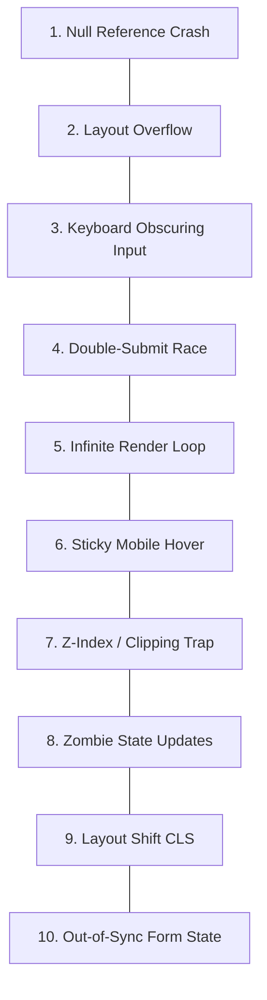

# UI Bug Prevention & Defensive Programming

> The top 10 recurring UI engineering bugs, root cause analyses, and defensive coding techniques to eliminate them.

---

## 1. Purpose

Most UI bugs are not mysterious runtime anomalies; they are predictable errors that repeat across codebases due to careless handling of asynchronous data, mobile keyboards, viewport constraints, and closures. 

This guide outlines defensive programming patterns to prevent the top 10 UI bugs before they reach code review.

---

## 2. The Top 10 Recurring UI Bugs & Defenses



### 1. Null Reference & Undefined Property Crashes
- **Root Cause**: Attempting to access nested properties on API data before the payload arrives (e.g. `user.profile.avatar`).
- **Defensive Pattern**: Use optional chaining (`user?.profile?.avatar`) and supply fallback defaults (`user?.name ?? 'Guest'`). Always type API responses strictly.

### 2. Layout Overflow & Container Blowout
- **Root Cause**: Long unbroken strings (e.g. URLs or German compound words) pushing flex containers beyond viewport boundaries.
- **Defensive Pattern**: Add `min-w-0` (`min-width: 0`) and `overflow-hidden` to flex children. Combine with `break-words` or `truncate`.

### 3. Keyboard Obscuring Inputs on Mobile
- **Root Cause**: The soft virtual keyboard covers the bottom half of a form, hiding the active input and submit button.
- **Defensive Pattern**: Wrap forms in scrollable, keyboard-aware containers:
  - **Flutter**: `SingleChildScrollView` + `MediaQuery.viewInsetsOf(context)`.
  - **React Native**: `KeyboardAvoidingView`.
  - **Web**: Keep inputs scrollable and support `scrollIntoView({ behavior: 'smooth' })`.

### 4. Double-Submit & Race Conditions
- **Root Cause**: An impatient user taps "Submit Order" three times rapidly, firing 3 duplicate charges.
- **Defensive Pattern**: Immediately disable the button upon first click (`disabled={isLoading}`) and abort previous pending requests with `AbortController`.

### 5. Infinite Re-Render Loops
- **Root Cause**: Creating object literals, inline arrays, or mutating state directly inside component render bodies or `useEffect` dependency arrays.
- **Defensive Pattern**: Never dispatch state changes in pure render functions. Ensure dependency arrays only track primitives or properly memoized values.

### 6. Sticky Hover States on Mobile Touchscreens
- **Root Cause**: CSS `:hover` styles remaining stuck in an active highlighted state after a user taps an element on iOS/Android touchscreens.
- **Defensive Pattern**: Restrict hover effects to fine pointer devices:
  ```css
  @media (hover: hover) and (pointer: fine) {
    .btn:hover { background-color: var(--color-hover); }
  }
  ```

### 7. Z-Index Wars & Parent Overflow Clipping
- **Root Cause**: A dropdown menu or modal being clipped by an ancestor with `overflow: hidden`, or covered by unrelated elements with arbitrary `z-index: 99999`.
- **Defensive Pattern**: Use portals (`createPortal` or Overlay in Flutter) to render dropdowns and modals at the document root level. Establish a strict 5-tier z-index scale (e.g. `z-base`, `z-sticky: 10`, `z-dropdown: 20`, `z-modal: 50`, `z-toast: 100`).

### 8. Zombie State Updates on Unmounted Components
- **Root Cause**: Calling `setState` or updating UI after a slow network request returns, but the user has already navigated away from the screen.
- **Defensive Pattern**: Cancel network subscriptions or use cleanup flags (`let isMounted = true; ... return () => { isMounted = false; }`).

### 9. Cumulative Layout Shift (CLS) from Images & Fonts
- **Root Cause**: Images rendering without explicit dimensions, popping into the DOM and shoving content down 300px.
- **Defensive Pattern**: Always specify `aspect-ratio` or `width`/`height` attributes on image wrappers. Use `font-display: swap` for web fonts.

### 10. Out-of-Sync Form State
- **Root Cause**: Storing identical form values in both local state and a global store, resulting in divergent states when validation fails.
- **Defensive Pattern**: Designate a single source of truth for form data.

---

## 3. Related Documentation

- Master Instructions: [../AGENTS.md](../AGENTS.md)
- Clean Code: [../engineering/clean-code.md](../engineering/clean-code.md)
- Error Handling: [../engineering/error-handling.md](../engineering/error-handling.md)
- UI Review Checklist: [ui-review.md](ui-review.md)
- Release Checklist: [release-checklist.md](release-checklist.md)

