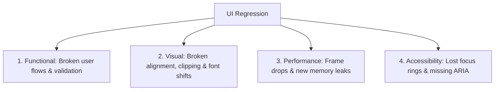

# Regression Prevention & Verification Protocol

> Methodologies for preventing functional, visual, accessibility, and performance regressions across code changes.

---

## 1. What is a Regression?

A **regression** is an unintended defect introduced into previously working software when adding a new feature, fixing a bug, or executing a refactor. In user interfaces, regressions are particularly insidious because they often pass unit tests while silently breaking visual layouts, touch targets, keyboard navigation, or scroll performance.

This protocol defines the mandatory verification gates to prevent regressions.

---

## 2. The 4 Dimensions of UI Regression

### 1. Functional Regressions
- An existing form validation rule is accidentally dropped during a component refactor.
- A button callback fails to fire under certain edge-case parameters.
- **Prevention**: Run existing test suites *before* modifying code; write regression tests covering the fix.

### 2. Visual Regressions
- Changing a global CSS utility or theme token alters padding in 15 unrelated views.
- Text overflows or wraps awkwardly on 375px mobile screens.
- **Prevention**: Compare before-and-after screenshots across mobile (375px), tablet (768px), and desktop (1280px).

### 3. Performance Regressions
- A refactored parent component now triggers 200 unnecessary child rebuilds on every keystroke.
- A long list previously virtualized is mistakenly rendered with a standard eager loop.
- **Prevention**: Audit list virtualization, verify `const` / memoization, and inspect disposal of new event listeners.

### 4. Accessibility Regressions
- Refactoring a `<button>` into a `
` strips keyboard navigation and screen reader semantics.
- Removing an explicit `aria-label` from an icon button during styling updates.
- **Prevention**: Perform a keyboard tab-through test and run accessibility linters before committing.

---

## 3. The 4-Step Regression Prevention Gate

Before opening a pull request or submitting changes:

1. **Verify Baseline Tests**: Confirm that all existing tests pass on the unmodified branch. If baseline tests are already failing, isolate and report existing failures before writing new code.
2. **Surgical Diff Audit**: Review the complete `git diff`:
   - Are there any changes in unrelated files?
   - Did any existing prop types or function signatures break?
   - Were any existing comments, docstrings, or tests deleted?
3. **Write a Dedicated Regression Test**: Every bug fix must include an automated test that reproduces the original failure and asserts that it is resolved.
4. **Multi-Viewport Visual Pass**: Inspect the modified UI at 375px, 768px, and 1280px in both Light and Dark modes.

---

## 4. Related Documentation

- Master Instructions: [../AGENTS.md](../AGENTS.md)
- Testing Standards: [testing.md](testing.md)
- UI Review Checklist: [ui-review.md](ui-review.md)
- Bug Prevention: [bug-prevention.md](bug-prevention.md)
- Release Checklist: [release-checklist.md](release-checklist.md)
- Change Control: [../core/change-control.md](../core/change-control.md)

