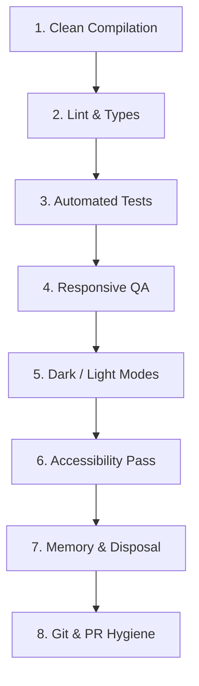

# Pre-Flight Release & PR Checklist

> The final quality gate that every pull request and feature deployment must pass before merge.

---

## 1. Purpose

The Release Checklist represents the final engineering boundary. It prevents regression defects, broken builds, styling anomalies, and accessibility lapses from entering production branches.

---

## 2. The 8-Point Pre-Flight Verification Gate

### 1. Build & Compilation
- [ ] Project builds cleanly with zero errors in release mode (`flutter build appbundle`, `flutter build ipa`, or `flutter build web`).
- [ ] No circular dependency warnings in the build log.

### 2. Static Analysis & Type Safety
- [ ] Static analysis passes with zero errors and zero warnings (`dart analyze`).
- [ ] Code formatting verified with `dart format --output=none --set-exit-if-changed .`.
- [ ] No remaining untyped `dynamic` variables in newly created widget constructors.

### 3. Automated Test Execution
- [ ] All existing test suites pass.
- [ ] New unit tests cover business logic, data transformers, and validation routines.
- [ ] Component/widget tests verify default, loading, disabled, and error states.

### 4. Responsive & Viewport Verification
- [ ] Verified at **Mobile** viewport (375px / 390px width): zero horizontal overflow, thumb-friendly tap targets.
- [ ] Verified at **Tablet** viewport (768px / 834px width): clean 2-column or drawer transitions.
- [ ] Verified at **Desktop** viewport (1280px / 1440px width): centered max-width container, proper hover states.

### 5. Theme & Color Consistency
- [ ] Verified in **Light Mode**: contrast ratios ≥ 4.5:1, surfaces clearly legible.
- [ ] Verified in **Dark Mode**: no invisible text, surfaces elevated with luminance, zero eye-straining high-saturation accents.

### 6. Accessibility (A11y) Conformance
- [ ] Full keyboard navigation operable via `Tab`, `Enter`, and `Space`.
- [ ] Focus rings clearly visible on all interactive elements.
- [ ] Icon-only buttons have explicit accessible labels (`aria-label`, `Semantics(label:)`).
- [ ] Dialogs trap focus and close on `Escape`.

### 7. Performance & Memory Hygiene
- [ ] All new event listeners, timers, subscriptions, and native controllers are explicitly removed/disposed of.
- [ ] Lists exceeding 20 items are virtualized.
- [ ] Image assets have explicit dimensions to eliminate Cumulative Layout Shift (CLS).

### 8. Git Hygiene & PR Documentation
- [ ] Commit message follows conventional commit format (`feat: ...`, `fix: ...`).
- [ ] Pull Request summary clearly lists:
  - What was added, modified, or removed.
  - Screenshots / recordings of the UI in both light and dark modes.
  - Test command execution status.

---

## 3. Related Documentation

- Master Instructions: [../AGENTS.md](../AGENTS.md)
- Testing Standards: [testing.md](testing.md)
- UI Review Checklist: [ui-review.md](ui-review.md)
- Performance Audit: [performance-audit.md](performance-audit.md)
- Bug Prevention: [bug-prevention.md](bug-prevention.md)
- Quality Report Template: [../templates/quality-report.md](../templates/quality-report.md)

