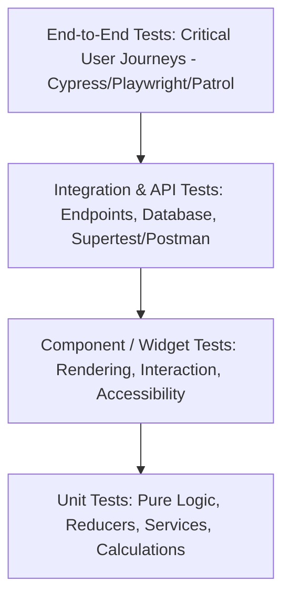
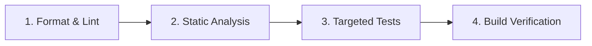

# Autonomous Testing Strategy & Verification Protocol

> **Unit, Component, Integration, API, E2E, Regression & Honest Reporting Standards**

Automated testing is the only objective proof that software behaves correctly. AI coding agents must apply targeted, proportional test strategies for every modification and report honest test results without fabrication.

---

## 1. The Autonomous Testing Pyramid



| Test Layer | Focus & Target | Execution Speed | Framework Tooling |
|---|---|---|---|
| **Unit Tests** | Pure functions, domain calculations, utilities, business rules | Milliseconds | Vitest, Jest, `test` (Dart), PyTest, JUnit 5, Go test |
| **Component Tests** | UI rendering, user interaction, state transitions, accessibility | Seconds | React Testing Library, Flutter WidgetTester, Compose UI Test |
| **API / Integration** | HTTP controllers, database transactions, middleware, auth | Seconds | Supertest, Testcontainers, Ktor Test, Httptest (Go) |
| **End-to-End (E2E)** | Full user journeys across real browsers / devices | Minutes | Playwright, Cypress, Maestro, Patrol, Appium |
| **Regression Tests** | Exact reproduction of previously fixed defects | Milliseconds–Seconds | Integrated into standard unit/component suite |

---

## 2. Proportional Test Selection Rule

> [!IMPORTANT]
> **Do Not Run the Entire Test Suite for Simple Changes**:
> Running a 45-minute suite for a single styling or documentation tweak is wasteful. Scope test execution to the blast radius of your changes:
> - **Edited utility function**: Run the targeted unit test file (`npm test src/lib/formatters.test.ts`).
> - **Edited UI component**: Run the component test and visual snapshot.
> - **Edited API route / schema**: Run the integration test for that endpoint.
> - **Full release / pre-flight**: Run the complete automated test suite.

---

## 3. Post-Modification Verification Sequence

After every code edit, execute this 4-step verification gate:



1. **Format & Lint**: Run project formatter/linter (`npm run lint`, `dart analyze`, `ruff check`).
2. **Static Type Analysis**: Verify zero type errors (`tsc --noEmit`, `mypy`, `cargo check`).
3. **Targeted Tests**: Run relevant unit/component tests and inspect outputs.
4. **Build Verification**: Run production build if dependencies or exports were altered (`npm run build`).

---

## 4. Honest Test Status Reporting Standard

When reporting test outcomes, AI agents MUST use these standardized statuses:

- **PASSED**: Command executed with exit code 0; all assertions confirmed green.
- **FAILED**: Command executed with non-zero exit code or assertion failure (quote exact error).
- **SKIPPED**: Test suite was intentionally bypassed (state explicit justification).
- **BLOCKED**: Test could not be run due to missing environment, database, or token.
- **NOT APPLICABLE**: Change does not impact executable logic (e.g., Markdown documentation).

```markdown
### Verification Summary
- Static Analysis (`tsc --noEmit`): **PASSED** (0 errors)
- Unit Tests (`npm test billing.test.ts`): **PASSED** (8 passed, 0 failed)
- Integration Tests: **BLOCKED** (Local Postgres container not running on port 5432)
- E2E Tests: **SKIPPED** (Proportional scope for minor billing logic patch)
```
