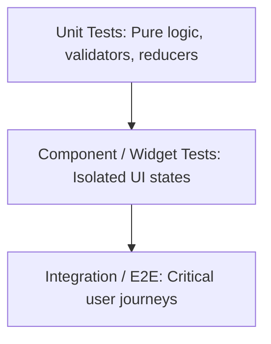

# UI Testing Standards & Verification

> Methodologies, test pyramids, resilient selector strategies, and reporting honesty for UI engineering.

---

## 1. Purpose

Untested user interfaces regress rapidly. However, fragile tests that break whenever an internal CSS class changes create maintenance friction without increasing confidence. 

This guide defines practical testing strategies for user interfaces across all platforms.

---

## 2. The UI Testing Pyramid



| Test Level | What It Verifies | Speed | Maintenance Cost |
|---|---|---|---|
| **Unit Tests** | Formatters, data mappers, form validation regex, reducers, pure utility functions | Ultra-fast (<1s) | Minimal |
| **Component / Widget Tests** | Single component rendering, prop variants, user interactions (tap, type), state toggles | Fast (seconds) | Low (if testing behavior, not markup) |
| **Integration / Flow Tests** | Multi-step user journeys (e.g. login flow, checkout sequence) with mocked APIs | Moderate | Moderate |
| **Visual Regression Tests** | Pixel-perfect screenshot diffs across viewport sizes | Slower | High |

---

## 3. Resilient Selector Strategy (Behavior Over Implementation)

Tests should interact with components the same way human users and screen readers do. Never query internal CSS classes, test IDs, or DOM tags when accessible roles exist:

```typescript
// Anti-Pattern: Brittle implementation selectors (breaks on simple CSS refactor)
const btn = wrapper.find('.btn-primary-blue-custom');
const input = wrapper.find('input[type="text"]:nth-child(2)');

// Best Practice: Accessible role & label selectors
const submitButton = screen.getByRole('button', { name: /save changes/i });
const emailInput = screen.getByRole('textbox', { name: /email address/i });
```

```dart
// Flutter Best Practice
expect(find.bySemanticsLabel('Submit Order'), findsOneWidget);
```

---

## 4. Mandatory Test Scenarios for Components

When authoring component or widget tests, cover these scenarios:
1. **The Default Render**: Component displays expected label, children, and attributes.
2. **Interactive Event**: Tapping or clicking dispatches the expected callback or event.
3. **Disabled State**: When `disabled={true}`, clicking does NOT fire the callback; element carries `aria-disabled="true"`.
4. **Loading State**: When `isLoading={true}`, displays spinner, hides/disables trigger, prevents double clicks.
5. **Error State**: Displays error message text with semantic styling and accessible association.

---

## 5. Strict Reporting Honesty (Mandatory Agent Rule)

AI coding agents must uphold absolute honesty regarding test execution:

> [!CAUTION]
> **NEVER claim tests passed unless you executed the test runner in the terminal and observed the pass code.**
> Fabricating test results or claiming "Tests passed: 100%" without running the suite is a severe violation.

When reporting test results, use this exact classification:
- **Passed**: Executed successfully with zero failures (include command and output summary).
- **Failed**: Executed and encountered errors (include the stack trace or failing assertion).
- **Skipped**: Test cases intentionally bypassed (explain why).
- **Blocked**: Unable to execute because dependencies, simulator, or environment was missing.

---

## 6. Related Documentation

- Master Instructions: [../AGENTS.md](../AGENTS.md)
- UI Review Checklist: [ui-review.md](ui-review.md)
- Bug Prevention: [bug-prevention.md](bug-prevention.md)
- Release Checklist: [release-checklist.md](release-checklist.md)
- Quality Report Template: [../templates/quality-report.md](../templates/quality-report.md)
