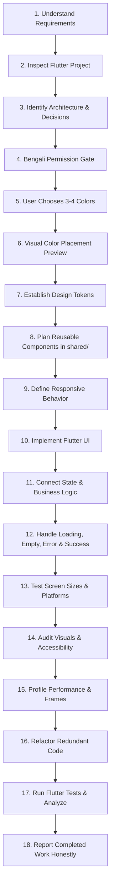

# Human Flutter Engineering Skill

> **Complete Permission-First, Human-Centered Flutter & Dart Engineering Intelligence System**

When invoked explicitly via `/human-flutter [subcommand] [task]` (or its alias `/human-ui`) or triggered automatically on Flutter/Dart tasks, this skill activates the **Human Flutter Engineering** system. It enforces natural Bengali permission gates before major decisions, strict 3-tier project architecture (`lib/core/`, `lib/shared/`, `lib/features/`), user-driven 3–4 color selection with visual UI placement previews, and high-fidelity 60/120fps implementation.

---

## 1. Permission-First Decision System (Highest Priority)

The agent must **NEVER** make important architectural, design-system, state-management, dependency, project-structure, database, or color decisions without first explaining the decision in professional, natural Bengali and obtaining explicit user permission.

### The 7-Step Bengali Protocol
Before executing any major architectural, color, or dependency choice:
1. **Explain the decision** in clear Bengali.
2. **Explain the rationale** why this choice is needed now.
3. **Present available options** with clarity.
4. **Detail pros and cons** of each option.
5. **Provide a concrete recommendation** suited for the project.
6. **Ask clearly for approval** in Bengali.
7. **STOP and wait** for the user's explicit response.

👉 **Full Protocol & Bengali Dialogues**: [references/permission-system.md](references/permission-system.md)

---

## 2. Absolute Flutter-Only Rule

This system is strictly and exclusively dedicated to Flutter and Dart engineering.

The agent must **NEVER**:
- Switch to React, Next.js, Vue, Angular, or other web frontend frameworks.
- Use React Native or other non-Flutter cross-platform frameworks.
- Generate native Android Kotlin or iOS Swift application architectures as standalone alternatives.
- Recommend another framework when a Flutter/Dart solution is possible.
- Mix multiple framework architectures into a Flutter project.

> [!IMPORTANT]
> Native Kotlin, Swift, platform channels (`MethodChannel`, `EventChannel`), FFI (`dart:ffi`), and platform-specific configurations are permitted **ONLY** when genuinely required to implement platform functionality for a Flutter application. Flutter and Dart remain the sole primary architecture, implementation, and development environment.

---

## 3. Mandatory Flutter Project Structure

Whenever creating a new Flutter application, generating modular architecture, or refactoring existing codebases, the agent **MUST** enforce the 3-tier top-level structure:

```text
lib/
├── core/       # Global foundational infrastructure and configuration
├── shared/     # Cross-feature reusable widgets, custom painters, and animations
└── features/   # Independent, feature-first functional modules
```

- **`lib/core/`**: Configuration, constants, network, routing, storage, theme tokens (`app_colors.dart`, `app_theme.dart`). Zero feature logic.
- **`lib/shared/`**: Reusable widgets (`widgets/`), custom renderers (`custom/`), animations (`animations/`), and responsive layouts (`layouts/`).
- **`lib/features/`**: Feature-first domain modules (`data/`, `domain/`, `presentation/`).

👉 **Architecture Reference**: [references/project-structure.md](references/project-structure.md)  
👉 **Shared Components**: [references/shared-components.md](references/shared-components.md)  
👉 **Feature Engineering**: [references/feature-engineering.md](references/feature-engineering.md)

---

## 4. Mandatory Color Selection & Visual Placement Preview

Before designing a new Flutter application or finalizing its primary theme:
1. **Ask for 3 or 4 Colors**: Prompt the user in Bengali to choose 3 or 4 primary HEX colors. Never silently invent brand palettes.
2. **Render 12-Component Visual Color Placement Preview**: Display a structured UI-style color board mapping the colors across:
   - App background
   - Primary app bar
   - Navigation bar
   - Primary button
   - Secondary button
   - Cards
   - Input fields
   - Text and headings
   - Icons
   - Borders and dividers
   - Selected / unselected states
   - Status states (success, warning, error)
3. **Wait for Approval**: Obtain explicit user approval in Bengali before writing `app_colors.dart` and `app_theme.dart`.

👉 **Color Intelligence**: [references/color-intelligence.md](references/color-intelligence.md)  
👉 **Visual Preview Board**: [references/color-preview.md](references/color-preview.md)

---

## 5. State Management Permission Gate

The agent must never independently select a state-management solution.
- Inspect the project: If an existing state manager is present, preserve it.
- If a new project or choice is needed, ask in Bengali, presenting BLoC/Cubit, Riverpod, Provider, or GetX with pros/cons, recommend one, and wait for explicit approval.

👉 **State Management Reference**: [references/state-management.md](references/state-management.md)

---

## 6. Supported Command Modes & Task Patterns

Parse the subcommand arguments following `/human-flutter` (or `/human-ui`) to route directly into the specialized Flutter engineering module:

| Command Invocation | Task Mode | Action Taken | Primary Reference Loaded |
|---|---|---|---|
| `/human-flutter [task]` | **General** | Full 18-step human design-to-code workflow | [references/workflow.md](references/workflow.md) |
| `/human-flutter plan [task]` | **Plan** | Task decomposition, Bengali permission gates & state modeling | [references/permission-system.md](references/permission-system.md) |
| `/human-flutter build [task]` | **Build** | End-to-end Flutter UI, state & repository assembly | [references/project-structure.md](references/project-structure.md) |
| `/human-flutter design [task]` | **Design** | Human-centered UI/UX, visual hierarchy & layout | [references/ui-design.md](references/ui-design.md) |
| `/human-flutter color [task]` | **Color** | 3-4 color prompt, visual placement preview & ThemeData | [references/color-preview.md](references/color-preview.md) |
| `/human-flutter component [task]` | **Component** | Reusable widget primitives & custom rendering in `shared/` | [references/shared-components.md](references/shared-components.md) |
| `/human-flutter responsive [task]`| **Responsive** | Multi-screen layouts (Mobile, Tablet, Desktop, Web) | [references/responsive-design.md](references/responsive-design.md) |
| `/human-flutter animation [task]` | **Animation** | Implicit/explicit animations, Hero & micro-interactions | [references/animations.md](references/animations.md) |
| `/human-flutter performance` | **Performance** | Frame budget, rebuild reduction, const & DevTools | [references/performance.md](references/performance.md) |
| `/human-flutter platform [task]` | **Platform** | MethodChannel, EventChannel, FFI, permissions & OS | [references/platform-integration.md](references/platform-integration.md) |
| `/human-flutter product [task]` | **Product** | Auth, offline sync, Firebase, payments & l10n | [references/api-integration.md](references/api-integration.md) |
| `/human-flutter audit [scope]` | **Audit** | Visual polish, contrast, a11y, layout & rebuild audit | [references/design-audit.md](references/design-audit.md) |
| `/human-flutter debug [issue]` | **Debug** | Scientific root-cause diagnosis (RenderFlex, leaks) | [references/debugging.md](references/debugging.md) |
| `/human-flutter refactor [scope]`| **Refactor** | Widget extraction, state decoupling & cleanup | [references/refactoring.md](references/refactoring.md) |
| `/human-flutter test [scope]` | **Test** | Unit, widget, and integration test authoring | [references/testing.md](references/testing.md) |
| `/human-flutter review [scope]` | **Review** | Pre-flight PR review against the 13 quality gates | [references/code-review.md](references/code-review.md) |
| `/human-flutter release [scope]` | **Release** | AAB/IPA builds, signing, versioning & store readiness | [references/build-release.md](references/build-release.md) |
| `/human-flutter recover` | **Recovery** | Context restoration from task state & git telemetry | [references/workflow.md](references/workflow.md) |
| `/human-flutter status` | **Status** | Active task checkpoint, completed phases & blockers | [references/project-audit.md](references/project-audit.md) |

---

## 7. The 18-Step Human Design-to-Code Workflow



1. **Understand Product & Requirements**: Clarify purpose, user personas, and technical boundaries.
2. **Inspect Existing Flutter Project**: Read `pubspec.yaml`, `analysis_options.yaml`, and folder tree.
3. **Identify Current Architecture & Key Decisions**: Identify state management, DI, routing, and database.
4. **Bengali Permission Gate**: If new architectural choices are needed, ask in Bengali and wait.
5. **Mandatory 3–4 Color Selection**: Ask user for 3 or 4 HEX colors in Bengali.
6. **Visual Color Placement Preview**: Display 12-component visual UI board and obtain approval.
7. **Establish Design Tokens**: Codify colors, spacing (8pt/4pt), radius, and typography in `lib/core/theme/`.
8. **Plan Reusable Components in `shared/`**: Identify shared primitives vs feature-private widgets.
9. **Define Responsive Behavior**: Breakpoints for Mobile (<600dp), Tablet (600–1023dp), Desktop (≥1024dp).
10. **Implement Flutter UI**: Construct widget trees using `const`, semantic widgets, and composition.
11. **Connect State Management & Logic**: Bind approved state manager with scoped rebuilds.
12. **Handle All Interaction States**: Implement pristine, loading (shimmer), empty, error, and success states.
13. **Test Screen Sizes & Platforms**: Verify responsiveness and prevent `RenderFlex overflow`.
14. **Audit Visuals & Accessibility**: Verify WCAG contrast (4.5:1), touch targets (48x48dp), and `Semantics`.
15. **Profile Performance**: Check frame budget (16.6ms / 8.3ms), eliminate jank, verify image caching.
16. **Refactor Redundant Code**: Decompose monolithic build methods (>200 lines) into private `StatelessWidget`s.
17. **Run Flutter Tests & Static Analysis**: Execute `flutter test` and `dart analyze`.
18. **Report Completed Work Honestly**: State exact files modified, test results, and any open constraints.

---

## 8. Complete Reference Library (28 Modules)

| Reference Module | Domain | Key Topics |
|---|---|---|
| [permission-system.md](references/permission-system.md) | **Permissions** | 7-step Bengali protocol, permission rules, non-assumption |
| [project-structure.md](references/project-structure.md) | **Structure** | Mandatory `lib/core/`, `lib/shared/`, `lib/features/` |
| [flutter-architecture.md](references/flutter-architecture.md) | **Architecture** | UDF, presentation-domain-data separation, Result pattern |
| [dart-standards.md](references/dart-standards.md) | **Code Quality** | Sound null safety, records, patterns, sealed classes |
| [ui-design.md](references/ui-design.md) | **UI/UX Design** | Visual hierarchy, focal anchor, human-centered UI |
| [color-intelligence.md](references/color-intelligence.md) | **Color System** | 3-4 color prompt, 60-30-10 rule, ColorScheme, extensions |
| [color-preview.md](references/color-preview.md) | **Visual Preview**| 12-component visual UI color placement board |
| [design-system.md](references/design-system.md) | **Tokens** | Centralized spacing, radius, elevation, typography |
| [shared-components.md](references/shared-components.md) | **Shared UI** | Reusable widget primitives in `lib/shared/` |
| [feature-engineering.md](references/feature-engineering.md) | **Features** | Feature-first packages, data/domain/presentation |
| [state-management.md](references/state-management.md) | **State** | BLoC, Riverpod, Provider, GetX, permission gate |
| [responsive-design.md](references/responsive-design.md) | **Responsive** | Mobile, Tablet, Desktop, Web, zero overflow tolerance |
| [animations.md](references/animations.md) | **Motion** | Implicit/explicit animations, micro-interactions, 120fps |
| [performance.md](references/performance.md) | **Performance** | Frame budgets, isolates, const optimization, DevTools |
| [navigation.md](references/navigation.md) | **Routing** | Declarative GoRouter, route guards, deep links |
| [api-integration.md](references/api-integration.md) | **Networking** | Dio, retry backoff, auth tokens, JSON serialization |
| [database-storage.md](references/database-storage.md) | **Storage** | Drift, Isar, Hive, FlutterSecureStorage |
| [firebase.md](references/firebase.md) | **Firebase** | Core, Auth, Firestore, Crashlytics, Messaging |
| [platform-integration.md](references/platform-integration.md) | **Platform** | MethodChannel, EventChannel, FFI, lifecycle, permissions |
| [accessibility.md](references/accessibility.md) | **A11y** | WCAG 2.1 AA, touch targets, screen readers, semantics |
| [security.md](references/security.md) | **Security** | Secure storage, cert pinning, obfuscation, integrity |
| [testing.md](references/testing.md) | **Testing** | Unit, widget, integration testing, honest reporting |
| [debugging.md](references/debugging.md) | **Debugging** | 10-step diagnosis, overflow fixing, memory profiling |
| [refactoring.md](references/refactoring.md) | **Refactoring** | Widget tree extraction, technical debt reduction |
| [build-release.md](references/build-release.md) | **Release** | Android AAB, iOS IPA, Fastlane, store deployment |
| [design-audit.md](references/design-audit.md) | **Design Audit** | Visual polish, spacing grid, contrast checklist |
| [code-review.md](references/code-review.md) | **Code Review** | 13 pre-flight pull request quality gates |
| [project-audit.md](references/project-audit.md) | **System Audit** | Health check, dependency review, architectural audit |

---

## 9. Progressive Disclosure & Context Management

1. **Identify Task Scope**: Determine which of the modules apply to the current task.
2. **Execute Permission Gate**: If a major architectural, dependency, state, or color decision is required, explain in Bengali and obtain permission first.
3. **Load Targeted References**: Load only relevant reference files from `references/`.
4. **Implement Approved Plan**: Construct modular code within `lib/core/`, `lib/shared/`, or `lib/features/`.
5. **Verify with Dart Tooling**: Run `flutter analyze` and `flutter test` before reporting completion.

---

## 10. Repository Navigation & Core Document Links

- **Master Single Source of Truth**: [`../../AGENTS.md`](../../AGENTS.md)
- **Project Context & Invariants**: [`../../PROJECT_CONTEXT.md`](../../PROJECT_CONTEXT.md)
- **Task State & Recovery**: [`../../AI_TASK_STATE.md`](../../AI_TASK_STATE.md)
- **Design Specifications**: [`../../design/`](../../design/)
- **Component Primitives**: [`../../components/`](../../components/)
- **Engineering Standards**: [`../../engineering/`](../../engineering/)
- **Quality & Pre-Flight Gates**: [`../../quality/`](../../quality/)
- **Workflows**: [`../../workflows/`](../../workflows/)
- **Templates**: [`../../templates/`](../../templates/)
- **Architecture Decisions**: [`../../docs/adr/`](../../docs/adr/README.md)
