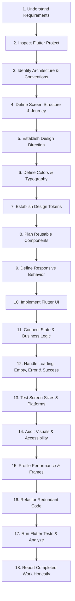

# Human Flutter Engineering Skill

> **Complete Human-Centered Flutter & Dart Engineering Operating System & Chat Command Orchestrator**

When invoked explicitly via `/human-flutter [subcommand] [task]` (or its alias `/human-ui`) or triggered automatically on Flutter/Dart engineering tasks, this skill activates the **Human Flutter Engineering** intelligence system. It enforces high fidelity, clean architecture, 60/120fps performance, WCAG accessibility, and platform-adaptive precision.

---

## 1. Absolute Flutter-Only Rule

This system is strictly and exclusively dedicated to Flutter and Dart engineering.

The agent must **NEVER**:
- Switch to React, Next.js, Vue, Angular, or other web frontend frameworks.
- Use React Native or other non-Flutter cross-platform frameworks.
- Generate native Android Kotlin or iOS Swift application architectures as standalone alternatives.
- Recommend another framework when a Flutter/Dart solution is possible.
- Mix multiple framework architectures into a Flutter project.

> [!IMPORTANT]
> Native Kotlin, Swift, platform channels (`MethodChannel`, `EventChannel`), FFI (`dart:ffi`), and platform-specific configurations are permitted **ONLY** when genuinely required to implement platform functionality for a Flutter application. Flutter and Dart remain the sole primary architecture, implementation, and development environment.

---

## 2. Supported Command Modes & Task Patterns

Parse the subcommand arguments following `/human-flutter` (or `/human-ui`) to route directly into the specialized Flutter engineering module:

| Command Invocation | Task Mode | Action Taken | Primary Reference Loaded |
|---|---|---|---|
| `/human-flutter [task]` | **General** | Full 18-step human design-to-code workflow | [references/workflow.md](references/workflow.md) |
| `/human-flutter plan [task]` | **Plan** | Task decomposition, dependency map & state modeling | [references/workflow.md](references/workflow.md) |
| `/human-flutter build [task]` | **Build** | End-to-end Flutter UI, state & repository assembly | [references/flutter-architecture.md](references/flutter-architecture.md) |
| `/human-flutter design [task]` | **Design** | Human-centered UI/UX, visual hierarchy & layout | [references/ui-design.md](references/ui-design.md) |
| `/human-flutter color [task]` | **Color** | Coherent palettes, ThemeData, ColorScheme & extensions | [references/color-system.md](references/color-system.md) |
| `/human-flutter component [task]` | **Component** | Reusable widget primitives & custom rendering | [references/components.md](references/components.md) |
| `/human-flutter responsive [task]`| **Responsive** | Multi-screen layouts (Mobile, Tablet, Desktop, Web) | [references/responsive-design.md](references/responsive-design.md) |
| `/human-flutter animation [task]` | **Animation** | Implicit/explicit animations, Hero & micro-interactions | [references/animation.md](references/animation.md) |
| `/human-flutter performance` | **Performance** | Frame budget, rebuild reduction, const & DevTools | [references/performance.md](references/performance.md) |
| `/human-flutter platform [task]` | **Platform** | MethodChannel, EventChannel, FFI, permissions & OS | [references/platform-integration.md](references/platform-integration.md) |
| `/human-flutter product [task]` | **Product** | Auth, offline sync, Firebase, payments & l10n | [references/api-integration.md](references/api-integration.md) |
| `/human-flutter audit [scope]` | **Audit** | Visual polish, contrast, a11y, layout & rebuild audit | [references/design-audit.md](references/design-audit.md) |
| `/human-flutter debug [issue]` | **Debug** | Scientific root-cause diagnosis (RenderFlex, leaks) | [references/debugging.md](references/debugging.md) |
| `/human-flutter refactor [scope]`| **Refactor** | Widget extraction, state decoupling & cleanup | [references/refactoring.md](references/refactoring.md) |
| `/human-flutter test [scope]` | **Test** | Unit, widget, and integration test authoring | [references/testing.md](references/testing.md) |
| `/human-flutter review [scope]` | **Review** | Pre-flight PR review against the 13 quality gates | [references/code-review.md](references/code-review.md) |
| `/human-flutter release [scope]` | **Release** | AAB/IPA builds, signing, versioning & store readiness | [references/build-release.md](references/build-release.md) |
| `/human-flutter recover` | **Recovery** | Context restoration from task state & git telemetry | [references/workflow.md](references/workflow.md) |
| `/human-flutter status` | **Status** | Active task checkpoint, completed phases & blockers | [references/project-audit.md](references/project-audit.md) |

---

## 3. The 18-Step Human Design-to-Code Workflow

Every non-trivial Flutter task follows this structured engineering workflow:

1. **Understand Product & Requirements**: Clarify purpose, target audience, and non-negotiables.
2. **Inspect Existing Flutter Project**: Read `pubspec.yaml`, `analysis_options.yaml`, and folder tree.
3. **Identify Current Architecture**: Detect state management (BLoC, Riverpod, Provider), DI, routing.
4. **Define Screen Structure & User Journey**: Map information architecture and navigation flows.
5. **Establish Design Direction**: Choose platform-adaptive, Material 3, Cupertino, or custom visual styling.
6. **Define Color System & Typography**: Establish `ColorScheme`, light/dark themes, and `TextTheme`.
7. **Define Spacing, Sizing, Radius & Tokens**: Set 4pt/8pt grid, elevation, and component dimensions.
8. **Plan Reusable Components**: Identify shared primitives (`AppButton`, `AppTextField`, `AppCard`).
9. **Define Responsive Behavior**: Specify breakpoints for Mobile, Tablet, Desktop, and Web.
10. **Implement Flutter UI**: Build declarative widget trees using `const`, semantic widgets, and composition.
11. **Connect State Management & Logic**: Bind BLoC/Cubit, Riverpod, or ChangeNotifier with scoped rebuilds.
12. **Handle All Interaction States**: Implement pristine, loading (shimmer), empty, error, and success states.
13. **Test Screen Sizes & Platforms**: Verify behavior across phones, tablets, desktop windows, and web viewports.
14. **Audit Visuals & Accessibility**: Verify WCAG contrast (4.5:1), touch targets (48x48dp), and `Semantics`.
15. **Profile Performance**: Check frame budget (16.6ms / 8.3ms), eliminate jank, verify image caching.
16. **Refactor Unnecessary Code**: Extract oversized widget trees (>200 lines) into private `StatelessWidget`s.
17. **Run Flutter Tests & Static Analysis**: Execute `flutter test` and `dart analyze`.
18. **Report Completed Work Honestly**: State exact files modified, test results, and any open constraints.

---

## 4. Progressive Disclosure & Context Management

To maintain an agile context window, **never load all documentation files simultaneously**. Follow this progressive protocol:

1. **Identify Task Scope**: Determine which of the 10 engineering areas (A–J) the task touches.
2. **Load Targeted Reference**: Load only the specific reference file from `references/`.
3. **Inspect Active Project**: Read the local project's `pubspec.yaml` and state management setup.
4. **Apply Flutter Quality Rules**: Enforce `const`, clean widget trees, and zero AI visual cliches.
5. **Verify with Dart Tooling**: Run `flutter analyze` or `flutter test` before reporting completion.

---

## 5. Repository Navigation & Core Document Links

- **Master Single Source of Truth**: [`../../AGENTS.md`](../../AGENTS.md)
- **Project Context & Invariants**: [`../../PROJECT_CONTEXT.md`](../../PROJECT_CONTEXT.md)
- **Task State & Recovery**: [`../../AI_TASK_STATE.md`](../../AI_TASK_STATE.md)
- **Design Specifications**: [`../../design/`](../../design/)
- **Component Primitives**: [`../../components/`](../../components/)
- **Engineering Standards**: [`../../engineering/`](../../engineering/)
- **Quality & Pre-Flight Gates**: [`../../quality/`](../../quality/)
- **Workflows**: [`../../workflows/`](../../workflows/)
- **Templates**: [`../../templates/`](../../templates/)
- **Architecture Decisions**: [`../../docs/adr/`](../../docs/adr/README.md)
