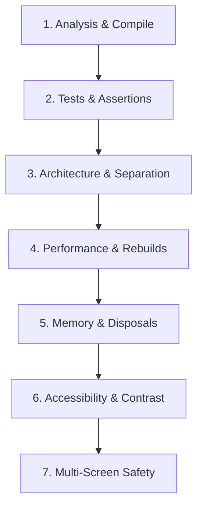

# Flutter Code Review & Pre-Merge Quality Gates

> Pre-flight code review protocol for Flutter pull requests, evaluating code against the 13 engineering quality gates.

---

## 1. Pre-Flight Review Protocol

Before approving or merging any Flutter pull request, inspect changes against these core gates:

---

## 2. The 8 Critical Review Gates

### Gate 1: Static Analysis Cleanliness
- [ ] `dart analyze` passes with **0 errors and 0 warnings**.
- [ ] Code is formatted cleanly with `dart format .`.

### Gate 2: Automated Test Verification
- [ ] All unit and widget tests pass (`flutter test`).
- [ ] New user flows or bugfixes include regression tests.
- [ ] No fake assertions (`expect(true, isTrue)`).

### Gate 3: Architectural Separation
- [ ] Presentation widgets contain no raw HTTP or SQL queries.
- [ ] Business logic resides in dedicated state containers (Cubit, Notifier, Bloc).
- [ ] Files adhere to the 200-line guideline; monolithic screens decomposed.

### Gate 4: Performance & Rebuild Scope
- [ ] Immutable widgets use `const` constructors.
- [ ] Rebuilds are scoped using `buildWhen`, `select`, or `ValueListenableBuilder`.
- [ ] Dynamic collections use `ListView.builder` or `CustomScrollView`.

### Gate 5: Memory Management & Resource Disposal
- [ ] All `AnimationController`, `TextEditingController`, and `ScrollController` instances disposed in `dispose()`.
- [ ] All `StreamSubscription`s cancelled when widget or controller unmounts.

### Gate 6: Accessibility (A11y)
- [ ] Interactive custom widgets wrapped in `Semantics(button: true, label: ...)`.
- [ ] Minimum tap targets (48x48dp) enforced on all touch triggers.
- [ ] Text contrast meets WCAG AA (4.5:1 text, 3:1 graphical).

### Gate 7: Multi-Screen & Overflow Safety
- [ ] Layout verified against `RenderFlex overflow` across small (320dp) and wide viewports.
- [ ] Text containers provide `overflow: TextOverflow.ellipsis` and `maxLines`.
- [ ] Keyboard dismissal and `SingleChildScrollView` handle form viewports.

### Gate 8: Security & Secret Sanitization
- [ ] No hardcoded passwords, tokens, or private keys committed to source.
- [ ] Credentials stored in `FlutterSecureStorage`.

---

## 3. Related References

- Quality Gates: [../../../quality/engineering-quality-gates.md](../../../quality/engineering-quality-gates.md)
- Testing: [testing.md](testing.md)
- Performance: [performance.md](performance.md)
