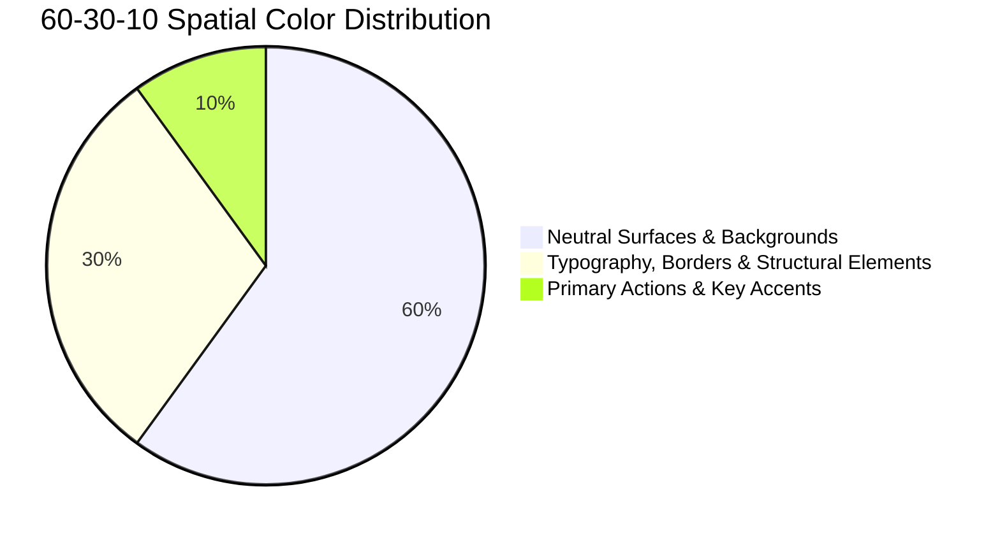

# Human Color Intelligence — Mandatory Selection & Architecture

> **Complete Color System Specification** for Flutter applications developed under the Human Flutter Engineering system.

Never choose colors randomly or silently invent primary brand palettes. The user must maintain definitive ownership over their application's visual brand identity.

---

## 1. Mandatory 3–4 Color Selection Protocol

Before designing a new Flutter application or establishing its visual theme, the agent **MUST** prompt the user in Bengali to select three or four base colors:

```text
আপনার অ্যাপ্লিকেশনের জন্য ৩টি অথবা ৪টি মূল রং (HEX কোডসহ) নির্বাচন করুন।

এই রংগুলোর ভিত্তিতে সম্পূর্ণ অ্যাপ্লিকেশনের Color System, ThemeData এবং ColorScheme তৈরি করা হবে।

প্রতিটি রং কোথায় এবং কীভাবে ব্যবহার হবে সেটিও আগে Visual Preview-তে দেখানো হবে।
```

### Collection Guidelines
1. **Prefer HEX Format**: Request `#RRGGBB` format (e.g., `#2563EB`, `#1E293B`, `#10B981`).
2. **Accept Curated Palettes**: If the user asks for suggestions, present 2–3 cohesive 3–4 color themes (e.g., Tech Sapphire, Emerald Health, Midnight Obsidian) and wait for approval.
3. **No Silent Defaults**: Under no circumstances should the agent initialize arbitrary colors without explicit user approval.

---

## 2. Deriving the Complete Semantic Color System

From the approved 3–4 primary colors, the system derives a mathematically balanced, accessible Material 3 `ColorScheme` for both Light and Dark modes.

### The 60-30-10 Rule
- **60% Dominant Neutral**: Backgrounds, surfaces, canvas, and cards (`colorScheme.surface`, `colorScheme.surfaceContainer`).
- **30% Structural Medium**: Text, headings, icons, borders, and structural outlines (`colorScheme.onSurface`, `colorScheme.outlineVariant`).
- **10% Intentional Accent**: Primary actions, key callouts, focus rings, and selection indicators (`colorScheme.primary`, `colorScheme.tertiary`).



### Core Token Hierarchy
| Role | Purpose | Contrast Target |
|---|---|---|
| `primary` | Key interactive actions, FAB, active nav | ≥ 4.5:1 against surface |
| `onPrimary` | Text and icons placed on primary | ≥ 4.5:1 against primary |
| `primaryContainer` | Subtle containers, selected chips | M3 tonal variance |
| `secondary` | Supporting actions, filters, tags | ≥ 3:1 against surface |
| `onSecondary` | Text and icons placed on secondary | ≥ 4.5:1 against secondary |
| `surface` | Card surfaces, modals, elevated sheets | Base luminance |
| `surfaceContainer` | Segmented list items, input fields | Low elevation delta |
| `onSurface` | Primary text and major icons | ≥ 7:1 against surface |
| `onSurfaceVariant` | Secondary captions, placeholders | ≥ 4.5:1 against surface |
| `outline` | Input borders, card dividers | ≥ 3:1 against surface |
| `error` | Destructive actions, validation errors | WCAG AA compliant |

---

## 3. Semantic Status Extensions (`ThemeExtension`)

Material 3's `ColorScheme` lacks explicit success, warning, and info semantics. Flutter applications implement these cleanly via `ThemeExtension<AppColors>`:

```dart
// lib/core/theme/app_colors.dart
import 'package:flutter/material.dart';

@immutable
class AppCustomColors extends ThemeExtension<AppCustomColors> {
  const AppCustomColors({
    required this.success,
    required this.onSuccess,
    required this.warning,
    required this.onWarning,
    required this.info,
    required this.onInfo,
  });

  final Color success;
  final Color onSuccess;
  final Color warning;
  final Color onWarning;
  final Color info;
  final Color onInfo;

  @override
  AppCustomColors copyWith({
    Color? success,
    Color? onSuccess,
    Color? warning,
    Color? onWarning,
    Color? info,
    Color? onInfo,
  }) {
    return AppCustomColors(
      success: success ?? this.success,
      onSuccess: onSuccess ?? this.onSuccess,
      warning: warning ?? this.warning,
      onWarning: onWarning ?? this.onWarning,
      info: info ?? this.info,
      onInfo: onInfo ?? this.onInfo,
    );
  }

  @override
  AppCustomColors lerp(ThemeExtension<AppCustomColors>? other, double t) {
    if (other is! AppCustomColors) return this;
    return AppCustomColors(
      success: Color.lerp(success, other.success, t)!,
      onSuccess: Color.lerp(onSuccess, other.onSuccess, t)!,
      warning: Color.lerp(warning, other.warning, t)!,
      onWarning: Color.lerp(onWarning, other.onWarning, t)!,
      info: Color.lerp(info, other.info, t)!,
      onInfo: Color.lerp(onInfo, other.onInfo, t)!,
    );
  }
}
```

---

## 4. Accessibility & Contrast Verification (WCAG 2.1 AA)

- **Normal Body Text**: Minimum contrast ratio of **4.5:1** against underlying surface.
- **Large Text (≥ 18pt or 14pt bold)**: Minimum contrast ratio of **3:1**.
- **Interactive UI Components & Icons**: Minimum contrast ratio of **3:1** against adjacent background.
- **Dark Mode Elevation**: Never use arbitrary pure `#000000` everywhere. Use tiered charcoal/slate surfaces (`#121826`, `#1E293B`, `#28334E`) with subtle tonal elevation to maintain depth perception.

---

## 5. Token Centralization Rule

> [!IMPORTANT]
> **Zero Hardcoded Colors**: Colors must **NEVER** be hardcoded directly inside feature widgets (e.g., `Color(0xFF2563EB)` or `Colors.blue`).  
> Always access colors via `Theme.of(context).colorScheme` or custom theme extensions:
> ```dart
> // ✅ Correct: Theme-aware access
> final colorScheme = Theme.of(context).colorScheme;
> final customColors = Theme.of(context).extension<AppCustomColors>()!;
> 
> Container(
>   color: colorScheme.surfaceContainer,
>   child: Text('Title', style: TextStyle(color: colorScheme.onSurface)),
> );
> ```
