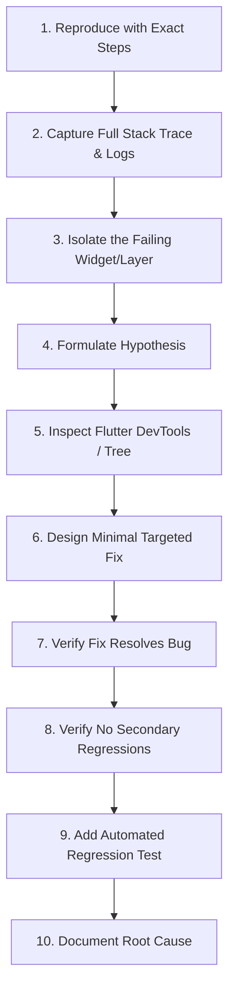

# Scientific Flutter Debugging Engine

> 10-step scientific root-cause debugging protocol for resolving Flutter layout overflows, render errors, state crashes, and memory leaks.

---

## 1. The 10-Step Scientific Debugging Method



1. **Reproduce Consistently**: Determine exact device, screen size, orientation, and user actions.
2. **Read the Full Exception**: Check terminal logs for the exact Flutter framework stack trace.
3. **Isolate the Scope**: Identify whether the defect is in layout constraints, async state, or data parsing.
4. **Formulate Hypothesis**: Explain *why* the failure occurs based on Flutter rendering laws.
5. **Inspect the Widget Tree**: Use the Flutter Widget Inspector or DevTools to inspect bounds.
6. **Implement Smallest Safe Fix**: Never execute broad rewrites when a localized layout fix suffices.
7. **Verify Locally**: Test on both small mobile screens (iPhone SE / 320dp) and large displays.
8. **Check Boundaries**: Verify edge cases (empty strings, null values, 0 items, device rotation).
9. **Write Regression Test**: Add a `testWidgets` or unit test that asserts the fix.
10. **Document Findings**: Record the root cause in PR description or task log.

---

## 2. Resolving Top 5 Flutter Runtime Errors

### 1. `RenderFlex overflowed by X pixels`
- **Cause**: Children in a `Row` or `Column` exceeded available main-axis constraints.
- **Diagnosis**: Identify whether children have intrinsic unbounded width/height.
- **Remedy**:
  - In `Row`: Wrap text or dynamic widgets in `Flexible` or `Expanded`.
  - In `Column`: Wrap scrollable content in `Expanded` or a `SingleChildScrollView`.

### 2. `Vertical viewport was given unbounded height`
- **Cause**: A scrollable widget (`ListView`, `GridView`) was placed inside a container with infinite height (e.g. `Column`).
- **Remedy**: Wrap the `ListView` in `Expanded(child: ListView.builder(...))`.

### 3. `setState() or markNeedsBuild() called during build`
- **Cause**: Modifying reactive state or triggering navigation synchronously inside a `build()` method.
- **Remedy**: Defer side effects until the build phase completes:
  ```dart
  WidgetsBinding.instance.addPostFrameCallback((_) {
    context.go('/next-screen');
  });
  ```

### 4. `Null check operator used on a null value`
- **Cause**: Unsafe use of `!` operator on a nullable variable that was unexpectedly null.
- **Remedy**: Replace `!` with safe pattern matching, default fallback (`??`), or early guard clause.

### 5. Memory Leaks / Unresponsive App After Navigating
- **Cause**: Controllers, timers, or stream subscriptions not disposed when route pops.
- **Remedy**: Audit `State.dispose()` and cancel all subscriptions.

---

## 3. Flutter DevTools Diagnostic Tools

- **Widget Inspector**: Toggle "Show Guidelines" to visualize widget boundaries and padding.
- **Debug Paint**: Turn on `debugPaintSizeEnabled = true` to see layout constraints live.
- **Network Profiler**: Inspect HTTP requests, payloads, status codes, and latency in real time.

---

## 4. Related References

- Debugging Engine: [../../../engineering/debugging-engine.md](../../../engineering/debugging-engine.md)
- Performance: [performance.md](performance.md)
- Responsive Design: [responsive-design.md](responsive-design.md)
