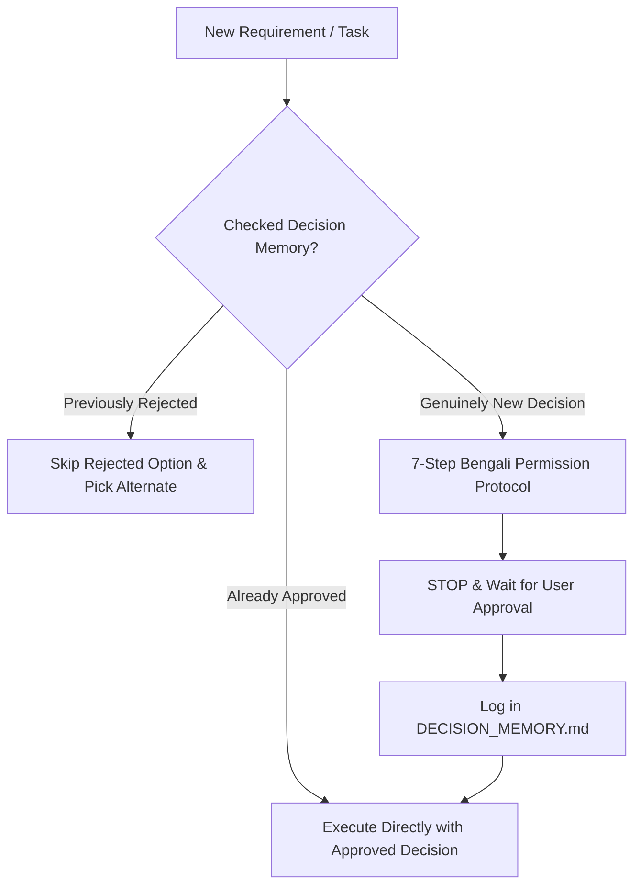

# Decision Memory System — Persistent Permission Register

> **System of Record** for all architectural, design, state management, dependency, and tooling decisions negotiated between the AI agent and the human developer in the Human Flutter Engineering ecosystem.

The Decision Memory System ensures that the AI agent honors the user's explicit choices, maintains context across sessions, and **never repeatedly pesters the developer with questions that have already been answered**.

---

## 1. Core Purpose & Architectural Invariants

In professional Flutter development, architectural choices (such as BLoC vs Riverpod, GoRouter vs AutoRoute, or custom brand palettes) are made once and adhered to globally across features.

The Decision Memory System provides:
1. **Zero Repetition**: Once an architectural choice is approved in Bengali, the agent permanently records it and applies it everywhere without re-asking.
2. **Context Persistence**: Even across agent restarts, context compactions, or new sessions, previous agreements remain binding.
3. **Audit Trail**: Every significant technical decision is documented with its rationale, date, and user approval trace.
4. **Negative Knowledge Preservation**: Rejected options are permanently remembered so the agent never re-proposes an architecture or library the user specifically disliked or prohibited.



---

## 2. The 5 Decision Memory Tiers

Decisions are partitioned into 5 explicit categories within the memory register:

### A. Approved Decisions (`APPROVED` — অনুমোদিত সিদ্ধান্ত)
Decisions that have gone through the 7-step Bengali protocol and received explicit approval from the developer.
- **Agent Behavior**: Implement autonomously across all current and future screens and features. Never re-ask for permission to use this pattern.

### B. Rejected Decisions (`REJECTED` — প্রত্যাখ্যাত সিদ্ধান্ত)
Decisions or packages that the user explicitly declined, prohibited, or voted against.
- **Agent Behavior**: Strictly forbidden from introducing, suggesting, or using these technologies or patterns in the codebase.

### C. Pending Decisions (`PENDING` — বিচারাধীন সিদ্ধান্ত)
Technical trade-offs that have been presented to the developer in Bengali but have not yet received an affirmative or negative response.
- **Agent Behavior**: Code generation in this domain is completely blocked. The agent must pause and await clarification.

### D. Project-Specific Decisions (`PROJECT` — প্রজেক্ট-নির্দিষ্ট পছন্দ)
Decisions bound strictly to the current Flutter repository (e.g. choice of Drift over Hive for this specific database schema, or a custom 4-color palette).
- **Agent Behavior**: Scoped to the active project; does not automatically leak into unrelated future projects unless promoted to global preferences.

### E. Global User Preferences (`GLOBAL` — সার্বজনীন ডেভেলপমেন্ট পছন্দ)
Universal engineering tastes and habits specified by the human developer (e.g., "Always use `fpdart` Result pattern", "Prefer `freezed` for data models", "Never use code-generation").
- **Agent Behavior**: Apply by default to any new Flutter project created by or for this developer.

---

## 3. Storage Specification: `DECISION_MEMORY.md`

Every Flutter application developed under the Human Flutter Engineering system maintains a top-level `DECISION_MEMORY.md` file in the project root.

### Canonical Schema

```markdown
# Project Decision Memory: [Project Name]

> Immutable and active architectural decisions registered through the Permission-First Bengali Protocol.

| ID | Date | Category | Decision | Status | Rationale / Approved By |
|---|---|---|---|---|---|
| DEC-001 | 2026-11-07 | State Management | flutter_bloc + cubit | APPROVED | Structured, scalable event-state architecture approved by user |
| DEC-002 | 2026-11-07 | Routing | go_router | APPROVED | Declarative URL-based routing with route guards |
| DEC-003 | 2026-11-07 | Local Storage | Isar Database | REJECTED | User prefers Drift for SQL schema migration safety |
| DEC-004 | 2026-11-07 | Color Palette | 4-Color Corporate | APPROVED | Primary: #1E3A8A, Secondary: #0D9488, Neutral: #F8FAFC, Accent: #F59E0B |
```

---

## 4. Agent Operational Rules

### Rule 1: Step 0 Pre-Flight Memory Check
Before presenting any decision to the user in Bengali, the agent **MUST** read `DECISION_MEMORY.md` (or inspect `AI_TASK_STATE.md`).
- If a relevant decision is marked `APPROVED`, proceed immediately using that decision without prompting the user.
- If a relevant decision is marked `REJECTED`, omit that option from any future proposal.

### Rule 2: Synchronous Registration Upon Approval
The instant a user replies with an affirmative response (e.g., "হ্যাঁ", "BLoC ব্যবহার করুন", "Option 1 অনুমোদিত", "Approved") to a 7-step Bengali prompt, the agent MUST:
1. Append the new decision to `DECISION_MEMORY.md` with status `APPROVED`.
2. Reference the decision ID (e.g. `[DEC-005]`) in subsequent git commit messages or task checkpoints.

### Rule 3: Graceful Decision Reversal
If the developer explicitly states they wish to change an earlier decision (e.g., "আমরা BLoC এর পরিবর্তে Riverpod এ মাইগ্রেট করতে চাই"):
1. The agent must acknowledge the requested transition in Bengali.
2. Update the previous record in `DECISION_MEMORY.md` to `SUPERSEDED` with a pointer to the new ID.
3. Log the new decision as `APPROVED`.
4. Formulate a structured migration plan before touching code.

---

## 5. Decision Categories Register

The agent records and tracks choices across these 12 core domains:

1. **Architecture**: Clean Architecture, Presentation-Domain-Data separation, UDF.
2. **State Management**: BLoC/Cubit, Riverpod, Provider, ValueNotifier.
3. **Routing & Navigation**: GoRouter, AutoRoute, Navigator 2.0.
4. **Dependency Injection**: get_it, injectable, Riverpod ref.
5. **Network & API**: Dio, Http, Retrofit, Chopper.
6. **Local Storage & Database**: Drift, Isar, Hive, FlutterSecureStorage, SharedPreferences.
7. **Color System & Theme**: 3-4 Primary HEX Colors, Dark Mode strategy, ColorScheme mappings.
8. **Typography & Styling**: Google Fonts, local assets, Material 3 typography tokens.
9. **Component Library**: Custom `lib/shared/` widgets vs Material/Cupertino primitives.
10. **Form & Validation**: Reactive forms, flutter_form_builder, custom pure Dart validators.
11. **Testing Strategy**: Mocktail, Mockito, Golden tests, Patrol, IntegrationTestWidgetsFlutterBinding.
12. **Native Platform Integrations**: MethodChannel plugins, FFI, camera, geolocation, biometrics.
