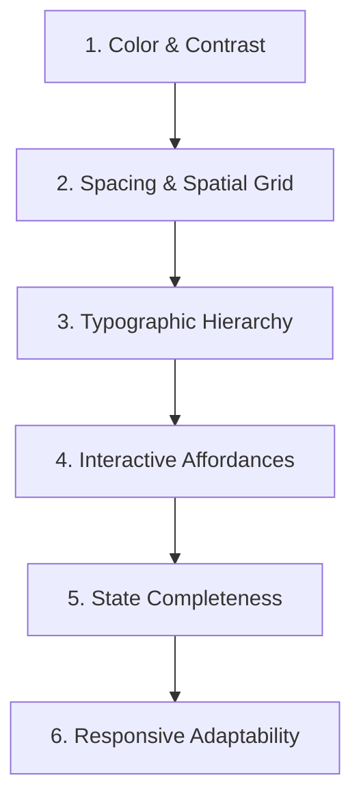

# Flutter UI Design & Polish Audit

> Systematic checklist and auditing protocol for visual hierarchy, spacing, contrast, and interactive polish in Flutter apps.

---

## 1. The 6-Dimension UI Polish Audit

---

## 2. Audit Checklist

### 1. Color & Contrast
- [ ] Body copy achieves at least 4.5:1 contrast against surface (`onSurface` vs `surface`).
- [ ] Headings and large text achieve at least 3.0:1 contrast.
- [ ] Interactive icons and input borders achieve at least 3.0:1 contrast.
- [ ] Dark theme verified: no harsh pure `#000000` pitch black where subtle tinted elevation is required.
- [ ] No hardcoded random hex codes; all colors resolve via `Theme.of(context).colorScheme` or `ThemeExtension`.

### 2. Spacing & Spatial Grid
- [ ] All margins, padding, and gaps align to the mathematical 8pt/4pt grid (4, 8, 12, 16, 24, 32, 48).
- [ ] Outer screen padding is consistent (16dp on mobile, 24dp–32dp on tablet/desktop).
- [ ] Related elements are closer together than unrelated elements (Law of Proximity).

### 3. Typographic Hierarchy
- [ ] One clear dominant heading per screen (`headlineMedium` or `titleLarge`).
- [ ] Long labels specify `maxLines` and `overflow: TextOverflow.ellipsis`.
- [ ] Dynamic type verified: scaling font size to 1.3x does not cause `RenderFlex` overflow.

### 4. Interactive Affordances
- [ ] Minimum interactive touch target of 48x48dp enforced on all tap targets (`kMinInteractiveDimension`).
- [ ] Touch ripples (`InkWell`) or active press states present on all clickable elements.
- [ ] Disabled buttons clearly convey non-interactive state without disappearing.

### 5. State Completeness
- [ ] Loading state: Shimmer placeholder (`Skeletonizer` or custom) matches incoming content shape.
- [ ] Empty state: Distinct vector illustration, explanation, and clear primary action.
- [ ] Error state: Explanatory diagnostic message and a "Retry" button.

### 6. Responsive Adaptability
- [ ] Tested on small phones (iPhone SE, 320dp–375dp width): no overflow stripes.
- [ ] Tested on tablet/desktop viewports (≥768dp): layout reflows into multi-column or navigation rail.
- [ ] Content constrained to readable max width on desktop displays (≤1200dp).

---

## 3. Related References

- UI Design: [ui-design.md](ui-design.md)
- Color System: [color-system.md](color-system.md)
- Responsive Design: [responsive-design.md](responsive-design.md)
- UI Review Checklist: [../../../quality/ui-review.md](../../../quality/ui-review.md)
