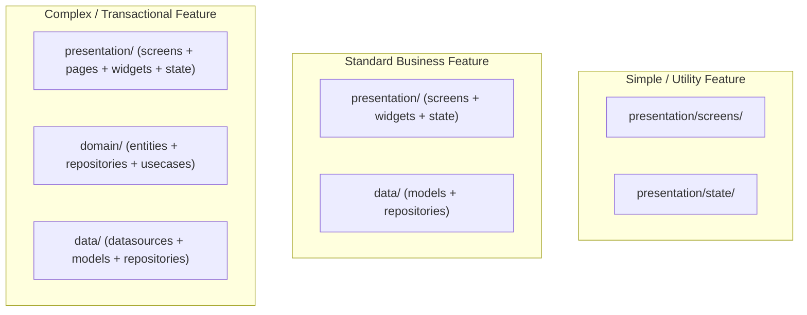

# Feature-First Engineering (`lib/features/`)

> **Architectural Specification** for building self-contained, scalable, and testable feature modules in `lib/features/`.

In the Human Flutter Engineering system, all domain capabilities, user journeys, and business flows live within self-contained feature packages. This architecture prevents monolithic spaghetti code and enforces clear boundaries between UI presentation, domain business rules, and external data sources.

---

## 1. Feature Directory Structure

Every substantial application capability resides in its own isolated subfolder within `lib/features/`:

```text
lib/features/
├── authentication/
│   ├── data/                   # Data Access Layer
│   │   ├── datasources/        # Remote API calls (Dio), local cache
│   │   ├── models/             # Data Transfer Objects (DTOs), JSON serialization
│   │   └── repositories/       # Concrete repository implementations
│   │
│   ├── domain/                 # Business Logic Layer (Clean Architecture)
│   │   ├── entities/           # Pure, immutable business models
│   │   ├── repositories/       # Abstract repository interfaces
│   │   └── usecases/           # Single-action business use cases
│   │
│   ├── presentation/           # Presentation Layer
│   │   ├── screens/            # Complete screen-level UI views
│   │   ├── pages/              # Tab or route composite pages
│   │   ├── widgets/            # Feature-private reusable widgets
│   │   ├── components/         # Micro-components scoped to this feature
│   │   └── state/              # State management (BLoC, Cubit, Notifier)
│   │
│   ├── authentication.dart     # Public barrel export
│   └── README.md               # Scope and dependency documentation
│
├── dashboard/
├── settings/
└── profile/
```

---

## 2. Screen & Page Organization Principles

To avoid confusing routing logic and duplicate screen wrappers:

- **`screens/`**: Complete, full-viewport Flutter widgets that represent a distinct user destination or navigation target (e.g., `LoginScreen`, `OrderDetailsScreen`).
- **`pages/`**: Sub-pages, nested tabs, or step views mounted inside a parent screen (e.g., `ProfileGeneralPage`, `ProfileSecurityPage`).
- **`widgets/`**: Reusable UI blocks shared across multiple screens *within this feature only* (e.g., `AuthHeaderWidget`, `SocialSignInRow`).
- **`components/`**: Small, highly specific atomic pieces scoped to a single screen (e.g., `PasswordStrengthIndicator`).
- **`state/`**: The state management controller, BLoC, Cubit, or Riverpod notifier driving this feature's UI.

---

## 3. Layer Separation & Responsibilities

### A. Presentation Layer
- **Responsibility**: Render UI declaratively based on immutable state and emit user intent (events/methods) to the state manager.
- **Rules**: Zero business logic in `build()` methods. Zero direct HTTP calls or database queries. Always access design tokens via `Theme.of(context)`.

### B. Domain Layer (Optional for Simple Features)
- **Responsibility**: Define the core business entities and rules of the enterprise.
- **Rules**: Completely pure Dart. **Zero Flutter UI imports** (`import 'package:flutter/material.dart'` is prohibited in domain). Use abstract repositories and single-responsibility `UseCase` classes.

### C. Data Layer
- **Responsibility**: Fetch raw data from network APIs, databases, or device sensors, deserialize JSON into models, and implement domain repository interfaces.
- **Rules**: Map raw exceptions into typed `Failure` objects before returning data to domain or presentation.

---

## 4. Scalability: Proportional Architecture

Do not blindly generate Clean Architecture boilerplate for trivial utility features:



- **Trivial Features** (e.g., About Screen, Splash): Single screen + minimal state.
- **Standard Features** (e.g., User Profile, Settings): Presentation + Data layers.
- **Mission-Critical Features** (e.g., Checkout, Authentication, Financial Ledger): Full 3-tier Clean Architecture with explicit use cases and test suites.

---

## 5. Cross-Feature Independence Rule

> [!CAUTION]
> Features must **NEVER** reach into another feature's internal presentation widgets:
> ```dart
> // ❌ FORBIDDEN: Cross-feature private widget import
> import 'package:app/features/profile/presentation/widgets/_profile_avatar.dart';
> 
> // ✅ PERMITTED: Use public shared component
> import 'package:app/shared/widgets/avatars/app_user_avatar.dart';
> 
> // ✅ PERMITTED: Call cross-feature domain repository via DI
> import 'package:app/features/authentication/domain/repositories/auth_repository.dart';
> ```

If a widget originally built inside `features/auth/` is needed by `features/profile/`, refactor and promote that widget into `lib/shared/widgets/`.
