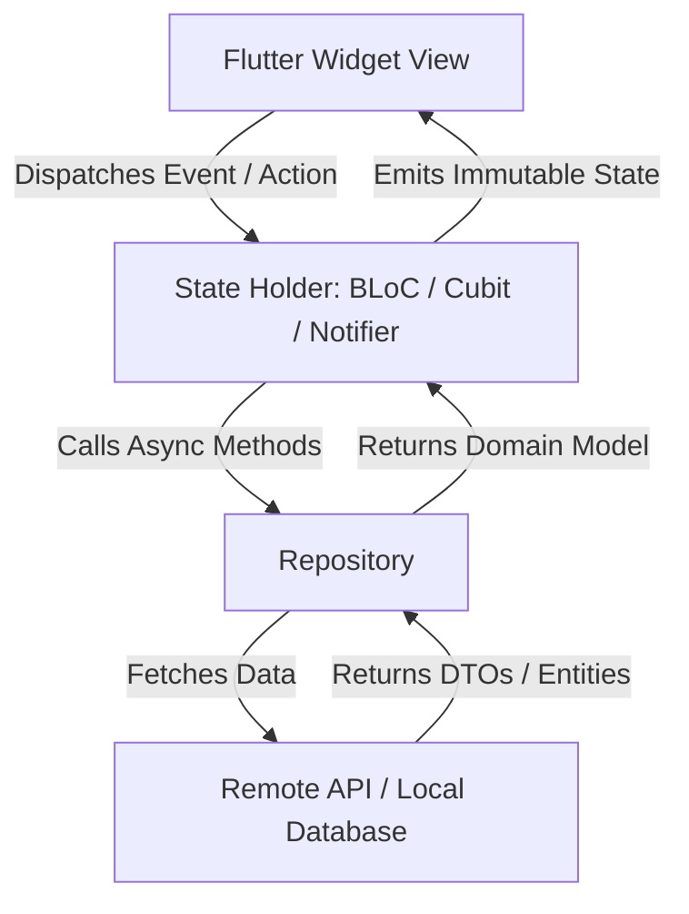

# Flutter Architecture & Clean Design

> Architectural patterns, presentation layer decoupling, and Unidirectional Data Flow (UDF) in Flutter applications.

---

## 1. Principles of Flutter Architecture

1. **Unidirectional Data Flow (UDF)**:
   - Data flows down from state containers to widgets.
   - Events/Intents flow up from user interactions to state holders.
   - Widgets remain passive, declarative views of the current state.
2. **Separation of Concerns**:
   - `presentation/`: Widgets, UI state controllers, animation drivers. No raw SQL or HTTP calls.
   - `domain/`: Business entities, value objects, use cases / interactors. Completely independent of Flutter UI libraries.
   - `data/`: DTOs, API clients, local SQLite/Drift databases, repository implementations.
3. **Proportional Architecture**: Choose architecture to fit project complexity. Never force Clean Architecture with 15 files per feature on a 2-screen utility app.

---

## 2. Unidirectional Data Flow (UDF)



---

## 3. Widget Granularity: Private Widgets vs Helper Methods

### Anti-Pattern: Helper Methods Returning Widgets
```dart
// BAD: Flutter cannot optimize rebuilds; entire parent rebuilds every time
Widget _buildUserProfile() {
  return Container(
    padding: const EdgeInsets.all(16),
    child: Text(user.name),
  );
}
```

### Best Practice: Dedicated Private `StatelessWidget` Classes
```dart
// GOOD: Flutter can skip rebuilding this sub-tree when user.name hasn't changed
class _UserProfileView extends StatelessWidget {
  final String userName;
  const _UserProfileView({required this.userName});

  @override
  Widget build(BuildContext context) {
    return Padding(
      padding: const EdgeInsets.all(16),
      child: Text(userName),
    );
  }
}
```

**Why this matters**:
- Private widgets have their own `BuildContext` and `Element`.
- Flutter compiler can mark them `const` when inputs are constants.
- Hot reload updates them independently without re-running parent logic.

---

## 4. SOLID in Flutter & Dart

- **Single Responsibility (SRP)**: A widget renders UI. A Cubit manages feature state. A Repository orchestrates data sources.
- **Open/Closed (OCP)**: Extend UI through widget composition (`child` or `builder` parameters) rather than modifying library source code.
- **Liskov Substitution (LSP)**: Custom state classes must be substitutable where base states are expected (use sealed classes in Dart 3).
- **Interface Segregation (ISP)**: Create focused abstract interfaces (`AuthRepository`, `UserRepository`) instead of a single giant `DataService`.
- **Dependency Inversion (DIP)**: Presentation controllers depend on repository interfaces, not concrete Dio/SQLite implementations.

---

## 5. Related References

- File Structure: [file-structure.md](file-structure.md)
- Dart Standards: [dart-standards.md](dart-standards.md)
- State Management: [state-management.md](state-management.md)
- Clean Code: [../../../engineering/clean-code.md](../../../engineering/clean-code.md)
