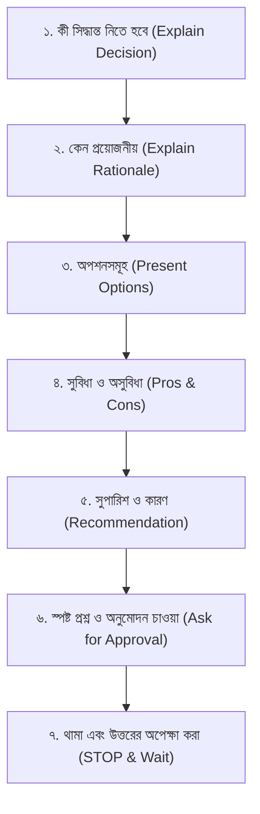

# Permission-First Decision System — Bengali Protocol

> **Highest Priority Operational Requirement** for all AI agents acting in the Human Flutter Engineering system.

The agent must **NEVER** make important architectural, design-system, state-management, dependency, project-structure, database, or primary color decisions without first explaining the decision in professional, natural Bengali and obtaining the user's explicit permission.

---

## 1. The 7-Step Bengali Permission Protocol

Before executing any substantial or impactful choice, the agent MUST execute this exact sequential protocol in natural Bengali (with technical names preserved in English):



1. **Explain what decision needs to be made** — স্পষ্ট ভাষায় বলুন কোন বিষয়ে সিদ্ধান্ত গ্রহণ প্রয়োজন।
2. **Explain why the decision is necessary** — ব্যাখ্যা করুন কেন এই সিদ্ধান্তটি এখনই নেওয়া আবশ্যক।
3. **Present the available options** — কার্যকর বিকল্প বা অপশনগুলো সংক্ষেপে তুলে ধরুন।
4. **Explain the advantages and disadvantages of each option** — প্রতিটি অপশনের শক্তি ও সীমাবদ্ধতা পরিষ্কার করুন।
5. **Recommend the most appropriate option for the current project** — প্রজেক্টের স্কেল ও প্রয়োজন অনুযায়ী সেরা বিকল্পটি সুপারিশ করুন এবং কারণ দর্শান।
6. **Ask the user clearly whether they approve** — স্পষ্টভাবে ব্যবহারকারীর মতামত ও অনুমোদন চান।
7. **Wait for the user's response before proceeding** — **সম্পূর্ণ থেমে যান (STOP)** এবং ব্যবহারকারীর সম্মতি ছাড়া কোনো কোড বা ফাইল লিখবেন না।

---

## 2. Mandatory Permission Rules

The agent **MUST** obtain explicit permission in Bengali before:

- Selecting or altering **State Management** (e.g., BLoC, Riverpod, Provider, GetX).
- Selecting or altering a **Routing Solution** (e.g., `go_router`, `auto_route`, Navigator 2.0).
- Selecting a **Dependency Injection / Service Locator** approach (e.g., `get_it`, `injectable`, Riverpod providers).
- Adding any new **Third-Party Package or Dependency** to `pubspec.yaml`.
- Altering the **Project Architecture** or changing the mandatory `lib/core/`, `lib/shared/`, `lib/features/` structure.
- Changing an **Existing File Structure** or moving files across boundaries.
- Introducing a new **Design System** or UI theme direction.
- Selecting the application's **Primary Brand Color Palette** (3–4 colors).
- Choosing major **UI/UX Directions** or layout paradigms.
- Introducing a new **Database or Local Storage Solution** (e.g., Drift, Isar, Hive, SharedPreferences).
- Introducing a new **API Architecture or Networking Client** (e.g., Dio, Http, GraphQL, Retrofit).
- Performing significant **Native Platform Integrations** (MethodChannel, platform plugins, FFI).
- Removing **Existing Files or Functionality**.
- Performing **Large-Scale Refactoring** of working code.
- Changing **Existing Application Behavior** or business flows.

---

## 3. Scope Boundaries: When NOT to Ask

To maintain efficient developer velocity without micro-management:

- **Do NOT ask permission for small implementation details**: Padding values, widget compositing order, private helper class names, standard null safety handling, or standard `const` constructor optimizations.
- **Do NOT re-ask for already approved decisions**: Once the user approves a state management or color palette, implement that approved decision across screens without repeatedly asking about the exact same decision.
- **Ask again ONLY if an independent, new decision becomes necessary**.
- **Preserve existing decisions**: If the requested task can be completed without altering an existing decision, strictly preserve the existing code and architecture.

---

## 4. Strict Non-Assumption Rules

> [!CAUTION]
> - **Never interpret silence as permission**: If the user has not explicitly replied to a decision prompt, do not start implementing.
> - **Never interpret a vague response as approval**: If the user says "maybe" or "what about X?", clarify in Bengali before executing.
> - **All permission questions and decision explanations MUST be in Bengali**. Technical names and code identifiers remain in standard English.

---

## 5. Concrete Bengali Dialogue Examples

### A. State Management Decision Example
```text
আপনার Flutter প্রজেক্টে State Management নির্বাচন করতে হবে।

এই সিদ্ধান্তটি নেওয়া প্রয়োজন কারণ প্রজেক্টের ডেটা ফ্লো, টেস্টেবিলিটি এবং স্কেলেবিলিটি এর ওপর নির্ভর করে।

নিচের অপশনগুলো বিবেচনা করা যেতে পারে:
1. BLoC/Cubit — Structured, predictable এবং বড় এন্টারপ্রাইজ প্রজেক্টের জন্য অত্যন্ত উপযোগী।
   - সুবিধা: ইভেন্ট-ড্রিভেন আর্কিটেকচার, টেস্ট করা সহজ।
   - অসুবিধা: বয়লারপ্লেট কোড তুলনামূলক বেশি।
2. Riverpod — Compile-safe, reactive এবং কোনো BuildContext ছাড়াই গ্লোবাল স্টেট ম্যানেজ করা যায়।
   - সুবিধা: অত্যন্ত ফ্লেক্সিবল, কোনো রুট কনটেক্সট ডিপেন্ডেন্সি নেই।
   - অসুবিধা: লার্নিং কার্ভ কিছুটা খাড়া।
3. Provider — অফিসিয়াল ও তুলনামূলক সহজ স্টেট ম্যানেজমেন্ট।
   - সুবিধা: দ্রুত কোড লেখা যায়, ছোট-মাঝারি প্রজেক্টের জন্য চমৎকার।
   - অসুবিধা: খুব বড় অ্যাপে বড় স্টেট ট্রির ক্ষেত্রে জটিল হতে পারে।

আমার সুপারিশ: BLoC/Cubit।
কারণ: আপনার প্রজেক্টের ফিচারের পরিধি এবং দীর্ঘমেয়াদী মেইনটেইনেবিলিটির জন্য এটি সর্বোচ্চ সুশৃঙ্খল পরিবেশ দেবে।

আপনি কি BLoC/Cubit ব্যবহারে একমত, নাকি অন্য কোনো অপশন বেছে নিতে চান?
```
*(এরপর এজেন্ট কোড না লিখে ব্যবহারকারীর উত্তরের জন্য সম্পূর্ণ থেমে থাকবে।)*

### B. Color Selection Prompt Example
```text
আপনার অ্যাপ্লিকেশনের জন্য ৩টি অথবা ৪টি মূল রং (HEX কোডসহ) নির্বাচন করুন।

এই রংগুলোর ভিত্তিতে সম্পূর্ণ অ্যাপ্লিকেশনের Color System, ColorScheme এবং Dark/Light Theme তৈরি করা হবে।

প্রতিটি রং অ্যাপ্লিকেশনের কোন কোন উপাদানে (Background, Buttons, Cards, Inputs, Status) কীভাবে ব্যবহার হবে, তা চূড়ান্ত থিম কোড করার আগেই একটি Visual Color Placement Preview-তে আপনাকে দেখানো হবে।

আপনার পছন্দের রংগুলো কী কী?
```

### C. Package / Dependency Addition Example
```text
প্রজেক্টে নেটওয়ার্ক রিকোয়েস্ট হ্যান্ডেল করার জন্য একটি HTTP ক্লায়েন্ট প্যাকেজ যুক্ত করতে হবে।

বিকল্পসমূহ:
1. dio — ইন্টারসেপ্টর, অটোমেটিক রিট্রাই এবং টোকেন রিফ্রেশ সুবিধা রয়েছে।
2. http — লাইটওয়েট এবং অফিশিয়াল ডার্ট প্যাকেজ।

আমার সুপারিশ: dio প্যাকেজ যোগ করা।
আপনি কি `pubspec.yaml`-এ `dio` যুক্ত করার অনুমোদন দিচ্ছেন?
```

---

## 6. Integration Checklist for Agents

When handling any user task:
- [ ] Inspect the workspace to check if the decision was already established.
- [ ] If already established in codebase or context, preserve it without asking.
- [ ] If a new major decision is required, compose the 7-step Bengali message.
- [ ] Request approval clearly and terminate agent turn immediately.
- [ ] Resume work only after explicit confirmation is received.
