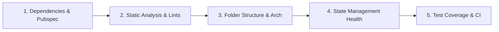

# Flutter Project Health & Architecture Audit

> Whole-repository diagnostic and health auditing guide for Flutter projects.

---

## 1. Project Audit Dimensions

When evaluating an existing Flutter codebase or starting a major refactor:

---

## 2. Audit Checklist

### 1. Dependencies & Pubspec (`pubspec.yaml`)
- [ ] Modern Dart SDK constraint declared (`sdk: ^3.3.0` or higher).
- [ ] No abandoned or unmaintained packages from pub.dev.
- [ ] No conflicting duplicate utility libraries (e.g. having both `get_it` and custom service locators).
- [ ] Assets and fonts referenced in `pubspec.yaml` actually exist on disk.

### 2. Static Analysis Configuration (`analysis_options.yaml`)
- [ ] Strict mode enabled (`strict-casts: true`, `strict-inference: true`, `strict-raw-types: true`).
- [ ] Lint package included (`package:flutter_lints/flutter.yaml`).
- [ ] Zero analysis errors or deprecation warnings across `lib/` and `test/`.

### 3. Folder Structure & Modularity
- [ ] Feature-First or Clean Layered architecture observed consistently.
- [ ] Universal UI primitives isolated in `lib/core/widgets/`.
- [ ] Feature-private widgets kept inside `features/<feature>/presentation/widgets/`.
- [ ] Tests in `test/` mirror the `lib/` directory structure.

### 4. State Management Health
- [ ] Exactly one primary state management solution used across business domains.
- [ ] UI widgets do not perform direct asynchronous network or database calls.
- [ ] Subscriptions and controllers are safely disposed.

### 5. Automated Testing & Verification
- [ ] Core business repositories and state controllers backed by automated tests.
- [ ] Critical UI flows covered by widget tests.
- [ ] Continuous Integration runs `dart analyze` and `flutter test` on all PRs.

---

## 3. Related References

- Architecture: [flutter-architecture.md](flutter-architecture.md)
- File Structure: [file-structure.md](file-structure.md)
- Code Review: [code-review.md](code-review.md)
