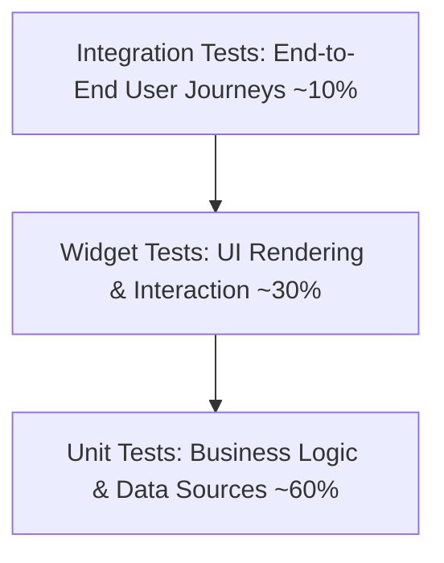

# Flutter Testing Strategy & Pyramid

> Multi-tier testing strategy in Flutter: Unit tests, Widget tests, Golden tests, and Integration tests.

---

## 1. The Flutter Testing Pyramid



- **Unit Tests (~60%)**: Fast, headless execution. Verify pure Dart classes, use cases, repositories, and state controllers (Cubit, Notifier).
- **Widget Tests (~30%)**: Simulated widget tree execution (`WidgetTester`). Verify UI rendering, conditionals, loading states, and user interactions without an emulator.
- **Integration Tests (~10%)**: Real device/simulator execution (`package:integration_test`). Verify end-to-end user journeys (login, checkout, database persistence).

---

## 2. Unit Testing State Holders

```dart
// test/features/cart/cart_cubit_test.dart
import 'package:test/test.dart';
import 'package:bloc_test/bloc_test.dart';
import 'package:mocktail/mocktail.dart';

class MockCartRepository extends Mock implements CartRepository {}

void main() {
  late MockCartRepository mockRepo;
  late CartCubit cartCubit;

  setUp(() {
    mockRepo = MockCartRepository();
    cartCubit = CartCubit(repository: mockRepo);
  });

  tearDown(() => cartCubit.close());

  blocTest<CartCubit, CartState>(
    'emits [CartLoading, CartLoaded] when fetchCart succeeds',
    build: () {
      when(() => mockRepo.getCartItems()).thenAnswer((_) async => [ProductItem(id: '1')]);
      return cartCubit;
    },
    act: (cubit) => cubit.fetchCart(),
    expect: () => [
      isA<CartLoading>(),
      isA<CartLoaded>().having((s) => s.items.length, 'items length', 1),
    ],
  );
}
```

---

## 3. Widget Testing with WidgetTester

```dart
// test/core/widgets/app_button_test.dart
import 'package:flutter/material.dart';
import 'package:flutter_test/flutter_test.dart';

void main() {
  testWidgets('AppButton renders label and fires callback when tapped', (tester) async {
    bool tapped = false;

    await tester.pumpWidget(
      MaterialApp(
        home: Scaffold(
          body: AppButton(
            label: 'Checkout',
            onPressed: () => tapped = true,
          ),
        ),
      ),
    );

    // Verify label rendered
    expect(find.text('Checkout'), findsOneWidget);

    // Tap and settle animations
    await tester.tap(find.byType(AppButton));
    await tester.pumpAndSettle();

    expect(tapped, isTrue);
  });

  testWidgets('AppButton shows spinner and disables tap when isLoading is true', (tester) async {
    bool tapped = false;

    await tester.pumpWidget(
      MaterialApp(
        home: Scaffold(
          body: AppButton(
            label: 'Save',
            isLoading: true,
            onPressed: () => tapped = true,
          ),
        ),
      ),
    );

    expect(find.byType(CircularProgressIndicator), findsOneWidget);

    await tester.tap(find.byType(AppButton));
    await tester.pumpAndSettle();

    expect(tapped, isFalse);
  });
}
```

---

## 4. Integration Testing (E2E)

Run across physical devices or simulators:
```bash
flutter test integration_test/app_flow_test.dart
```

---

## 5. Honest Test Reporting Standard

When running tests during development:
- Run `flutter test` via terminal tool.
- Inspect exit codes and output directly.
- Report exact status: **PASSED**, **FAILED**, **BLOCKED**, or **SKIPPED**. Never claim tests passed without executing them.

---

## 6. Related References

- Quality Gates: [../../../quality/engineering-quality-gates.md](../../../quality/engineering-quality-gates.md)
- Testing Strategy: [../../../quality/testing-strategy.md](../../../quality/testing-strategy.md)
- Component Testing: [../../../components/component-testing.md](../../../components/component-testing.md)
