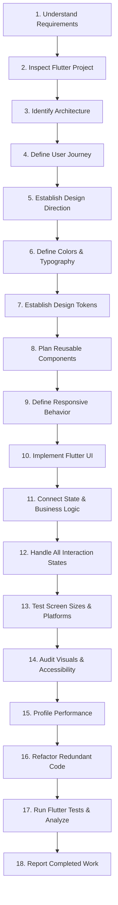

# The 18-Step Human Design-to-Code Workflow in Flutter

> The complete, sequential engineering lifecycle for authoring production-grade Flutter user interfaces.

---

## 1. Overview & Proportionality

Every substantial Flutter feature follows the structured 18-step workflow. For small, localized tasks (e.g. fixing a padding bug or adding an icon), agents apply a proportional workflow rather than executing unnecessary ceremony. However, project inspection, state verification, and testing must never be skipped.

---

## 2. The 18 Sequential Steps

### Step 1: Understand Product & User Requirements
- Analyze prompt constraints, user personas, brand identity, and technical boundaries.
- Distinguish non-negotiable requirements from flexible design choices.

### Step 2: Inspect Existing Flutter Project
- Inspect `pubspec.yaml`, dependencies, assets, and Flutter SDK constraints.
- Inspect `analysis_options.yaml` for strict lint rules.

### Step 3: Identify Current Architecture & Conventions
- Detect state management paradigm (BLoC, Riverpod, Provider).
- Check routing (`go_router`, Navigator 2.0) and dependency injection (`get_it`, Provider).

### Step 4: Define Screen Structure & User Journey
- Map screen information hierarchy, layout wireframes, and user interaction flows.

### Step 5: Establish Design Direction
- Choose between Material 3, Cupertino, or custom branded design. Reject generic AI aesthetics.

### Step 6: Define Color System & Typography
- Establish light and dark `ColorScheme` palettes, `ThemeExtension` for semantic statuses, and `TextTheme`.

### Step 7: Define Spacing, Sizing, Radius & Design Tokens
- Apply the 8pt/4pt mathematical spatial grid, corner radii, and elevation levels.

### Step 8: Plan Reusable Components
- Identify shared widget primitives (`AppButton`, `AppTextField`, `AppCard`) vs feature-private widgets.

### Step 9: Define Responsive Behavior
- Define multi-device layout behavior (Mobile < 600dp, Tablet 600–1023dp, Desktop/Web ≥ 1024dp).

### Step 10: Implement Flutter UI
- Construct declarative widget trees using `const` constructors and composition.

### Step 11: Connect State Management & Business Logic
- Bind BLoC/Cubit, Riverpod, or Notifiers to UI widgets with tightly scoped rebuilds.

### Step 12: Handle Loading, Empty, Error & Success States
- Implement shimmers for loading, clear empty states with CTAs, and actionable error banners.

### Step 13: Test on Screen Sizes & Platforms
- Verify responsiveness across mobile (portrait/landscape), tablet, and desktop viewports.

### Step 14: Audit Visual Consistency & Accessibility
- Check contrast ratios (WCAG 4.5:1), touch targets (min 48x48dp), and semantic labels.

### Step 15: Profile Performance
- Check frame budget (16.6ms / 8.3ms), eliminate unnecessary rebuilds, and ensure controller disposal.

### Step 16: Refactor Unnecessary or Duplicate Code
- Decompose monolithic build methods (>200 lines) into private `StatelessWidget`s.

### Step 17: Run Flutter Tests & Analyze Results
- Execute `flutter test` and `dart analyze`. Record actual pass/fail metrics.

### Step 18: Report Completed Work Honestly
- State files modified, components created, test outcomes, and any remaining constraints.

---

## 3. Autonomous Recovery Protocol

If an agent session is interrupted:
1. Read [`AI_TASK_STATE.md`](../../../AI_TASK_STATE.md) to inspect the last recorded checkpoint.
2. Run `git status` and `git diff` to inspect uncommitted changes.
3. Resume from the next pending step without discarding working code.

---

## 4. Related References

- Master Agent Instructions: [../../../AGENTS.md](../../../AGENTS.md)
- Development Workflow: [../../../core/development-workflow.md](../../../core/development-workflow.md)
- Recovery Protocol: [../../../core/recovery-protocol.md](../../../core/recovery-protocol.md)
