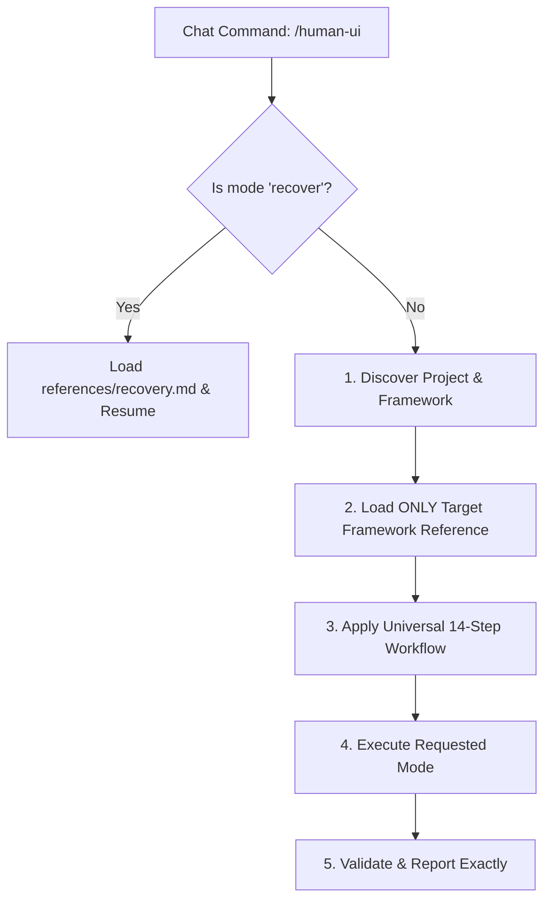

# Human UI Engineering Skill

> **Unified chat-box command and orchestration engine for human-grade user interface engineering.**

When invoked explicitly via `/human-ui [subcommand] [task]` or triggered automatically on UI engineering tasks, this skill activates the **Human UI Engineering** framework to deliver production-quality interfaces.

---

## 1. Supported Command Modes & Task Patterns

Parse the arguments following `/human-ui` to identify the task mode:

| Command Invocation | Task Mode | Action Taken | Reference Loaded |
|---|---|---|---|
| `/human-ui [task]` | **General** | Full 14-step workflow from discovery to validation | Framework-specific ref |
| `/human-ui design [task]` | **Design** | Human-centered UI design, typography, spacing, colors | [references/design.md](references/design.md) |
| `/human-ui audit [scope]` | **Audit** | Comprehensive UI polish, contrast, a11y, and layout audit | [references/audit.md](references/audit.md) |
| `/human-ui flutter [task]` | **Flutter** | Flutter-specific clean architecture, widget trees, BLoC/Riverpod | [references/flutter.md](references/flutter.md) |
| `/human-ui react [task]` | **React** | React/Vite functional components, hooks, virtualization | [references/react.md](references/react.md) |
| `/human-ui responsive [task]` | **Responsive** | Multi-breakpoint layouts, drawer/stack reflow, touch targets | [references/responsive.md](references/responsive.md) |
| `/human-ui performance [task]` | **Performance** | 60/120fps frame budgets, render optimization, memory leaks | [references/performance.md](references/performance.md) |
| `/human-ui debug [issue]` | **Debug** | Diagnose and fix layout overflow, null errors, sticky hover | [references/debug.md](references/debug.md) |
| `/human-ui recover` | **Recovery** | Restore context, inspect state & git, resume interrupted task | [references/recovery.md](references/recovery.md) |
| `/human-ui review [scope]` | **Review** | Architectural & code quality review against standards | [references/review.md](references/review.md) |

---

## 2. Progressive Disclosure & Execution Protocol

To avoid context window bloat, **NEVER load the entire repository documentation upfront**. Follow this 5-step progressive protocol:

### Step 1: Detect Mode & Check for Recovery
- If invoked with `recover` (or if an interrupted run is detected), immediately follow [Recovery Protocol](references/recovery.md).

### Step 2: Discover Project & Framework (Context Discovery)
Inspect repository manifests to identify the active framework and styling paradigm:
- `pubspec.yaml` -> **Flutter** (Load [references/flutter.md](references/flutter.md))
- `package.json` with `next` -> **Next.js** (Load [references/nextjs.md](references/nextjs.md))
- `package.json` with `react` -> **React** (Load [references/react.md](references/react.md))
- `build.gradle.kts` / `app/build.gradle` -> **Native Android** (Load [references/android.md](references/android.md))
- `Package.swift` / `*.xcodeproj` -> **Native iOS** (Load [references/ios.md](references/ios.md))
- `index.html` / standard CSS -> **Modern Web** (Load [references/web.md](references/web.md))

### Step 3: Apply Master Engineering Workflow
Anchor all execution in the 14-step workflow defined in [`AGENTS.md`](../../AGENTS.md):
1. Understand requirements & edge cases.
2. Inspect existing tokens and reusable primitives in `components/`.
3. Construct required foundations before assembling views.
4. Eliminate AI visual tropes (no gratuitous neon glows, card fatigue, or ungrounded glassmorphism).

### Step 4: Execute Task Mode with Scope Preservation
- Follow the specific instructions in the loaded reference file.
- **Preserve existing code**: Never overwrite, delete, or reformat unrelated business logic or user flows.

### Step 5: Verification & Honest Reporting
- Execute automated tests or static analysis (`npm test`, `flutter test`, `dart analyze`, `tsc --noEmit`).
- Report real results (Passed / Failed / Skipped / Blocked). Never fabricate validation outcomes.

---

## 3. Quick Reference Links

- Master Single Source of Truth: [`AGENTS.md`](../../AGENTS.md)
- Recovery Protocol: [references/recovery.md](references/recovery.md)
- Design Philosophy: [references/design.md](references/design.md)
- Task Routing & Mode Guide: [references/routing.md](references/routing.md)

