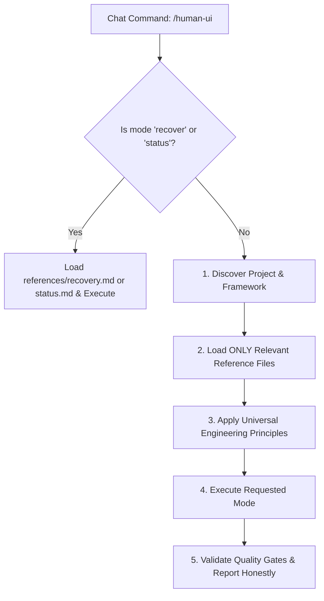

# Human UI Engineering Skill

> **Universal AI Software Engineering Operating System & Chat Command Orchestrator**

When invoked explicitly via `/human-ui [subcommand] [task]` or triggered automatically on engineering tasks, this skill activates the **Human UI Engineering** knowledge and workflow system to deliver production-grade software.

---

## 1. Supported Command Modes & Task Patterns

Parse the arguments following `/human-ui` to route into the appropriate task mode:

| Command Invocation | Task Mode | Action Taken | Primary Reference Loaded |
|---|---|---|---|
| `/human-ui [task]` | **General** | Full 14-step workflow from discovery to validation | Target Framework Reference |
| `/human-ui plan [task]` | **Plan** | Structured task decomposition, dependency map, risk analysis | [references/plan.md](references/plan.md) |
| `/human-ui build [task]` | **Build** | End-to-end full-stack feature assembly & testing | [references/build.md](references/build.md) |
| `/human-ui design [task]` | **Design** | Design tokens, visual hierarchy, spacing, typography | [references/design.md](references/design.md) |
| `/human-ui architect [task]` | **Architect** | Architecture evaluation & Architecture Decision Records (ADR) | [references/architect.md](references/architect.md) |
| `/human-ui audit [scope]` | **Audit** | Comprehensive UI polish, contrast, a11y, layout audit | [references/audit.md](references/audit.md) |
| `/human-ui debug [issue]` | **Debug** | Scientific 10-step root-cause diagnosis & smallest safe fix | [references/debug.md](references/debug.md) |
| `/human-ui refactor [scope]`| **Refactor** | Safe, behavior-preserving code extraction & cleanup | [references/refactor.md](references/refactor.md) |
| `/human-ui test [scope]` | **Test** | Multi-tier test authoring, execution & honest reporting | [references/test.md](references/test.md) |
| `/human-ui review [scope]` | **Review** | Pull request review against the 13 quality gates | [references/review.md](references/review.md) |
| `/human-ui security [scope]`| **Security** | Threat modeling, vulnerability audit, input sanitization | [references/security.md](references/security.md) |
| `/human-ui performance` | **Performance**| Frame budget, render optimization, memory & query latency | [references/performance.md](references/performance.md) |
| `/human-ui docs [scope]` | **Docs** | API contracts, docstrings, and project context updates | [references/docs.md](references/docs.md) |
| `/human-ui release [ver?]` | **Release** | Pre-flight release checks, semantic versioning & migrations | [references/release.md](references/release.md) |
| `/human-ui recover` | **Recovery** | Context restoration from task state & git telemetry | [references/recovery.md](references/recovery.md) |
| `/human-ui status` | **Status** | Display active task checkpoint, progress, and blockers | [references/status.md](references/status.md) |

---

## 2. Progressive Disclosure & Execution Protocol

To avoid context window bloat, **NEVER load the entire repository documentation upfront**. Follow this 5-step progressive protocol:

### Step 1: Detect Mode & Check for Recovery
- If invoked with `recover`, immediately load [references/recovery.md](references/recovery.md) and inspect [`AI_TASK_STATE.md`](../../AI_TASK_STATE.md).
- If invoked with `status`, immediately load [references/status.md](references/status.md) and report active progress.

### Step 2: Discover Project & Framework (Context Discovery)
Inspect codebase manifests to identify the active framework and runtime:
- `pubspec.yaml` -> **Flutter** (Load [references/flutter.md](references/flutter.md))
- `package.json` with `next` -> **Next.js** (Load [references/nextjs.md](references/nextjs.md))
- `package.json` with `react-native` / `expo` -> **React Native** (Load [references/react-native.md](references/react-native.md))
- `package.json` with `vue` / `nuxt` -> **Vue.js** (Load [references/vue.md](references/vue.md))
- `angular.json` / `@angular/core` -> **Angular** (Load [references/angular.md](references/angular.md))
- `package.json` with `react` -> **React** (Load [references/react.md](references/react.md))
- `build.gradle.kts` / `app/build.gradle` -> **Native Android** (Load [references/android.md](references/android.md))
- `Package.swift` / `*.xcodeproj` -> **Native iOS** (Load [references/ios.md](references/ios.md))
- `tauri.conf.json` / `electron` -> **Desktop** (Load [references/desktop.md](references/desktop.md))
- `go.mod` / `requirements.txt` / `Cargo.toml` -> **Backend** (Load [references/backend.md](references/backend.md))
- `prisma/` / `migrations/` / SQL scripts -> **Database** (Load [references/database.md](references/database.md))
- `index.html` / standard CSS -> **Modern Web** (Load [references/web.md](references/web.md))

### Step 3: Apply Master Engineering Workflow
Anchor execution in the universal core:
1. Understand requirements, true user intent, and technical constraints ([`../../core/developer-intelligence.md`](../../core/developer-intelligence.md)).
2. Inspect existing design tokens and reusable primitives in `components/`.
3. Construct required types and primitives before assembling views.
4. Eliminate AI visual tropes (no gratuitous neon glows, card fatigue, or ungrounded glassmorphism).

### Step 4: Execute Task Mode with Scope Preservation
- Follow the specific instructions in the loaded reference file.
- **Preserve existing code**: Never overwrite, delete, or reformat unrelated business logic or user flows.

### Step 5: Verification & Honest Reporting
- Execute automated tests or static analysis (`npm test`, `flutter test`, `dart analyze`, `tsc --noEmit`).
- Verify against the 13 quality gates in [`../../quality/engineering-quality-gates.md`](../../quality/engineering-quality-gates.md).
- Report real results (**PASSED**, **FAILED**, **SKIPPED**, **BLOCKED**, **NOT APPLICABLE**). Never fabricate validation outcomes.

---

## 3. Quick Reference Links

- Master Single Source of Truth: [`../../AGENTS.md`](../../AGENTS.md)
- Stable Project Context: [`../../PROJECT_CONTEXT.md`](../../PROJECT_CONTEXT.md)
- Active Task State Tracker: [`../../AI_TASK_STATE.md`](../../AI_TASK_STATE.md)
- Architecture Decision Records: [`../../docs/adr/`](../../docs/adr/README.md)
