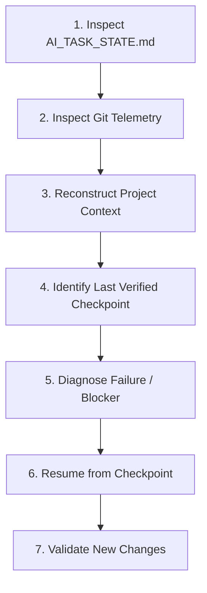

# Human UI Recovery Mode Protocol

> Protocol for `/human-ui recover` to restore interrupted context, inspect task state, diagnose failures, and resume work safely without restarting from scratch.

---

## 1. When to Use Recovery Mode

Activate this protocol whenever:
- The user issues `/human-ui recover`.
- A previous agent session was cut off due to timeout, token context limits, or tool crash.
- A build or test failure interrupted a multi-step UI migration.
- The project is left in an unknown or uncommitted intermediate state.

---

## 2. The 7-Step Recovery Execution Sequence



### Step 1: Inspect `AI_TASK_STATE.md` (If Present)
Look for an `AI_TASK_STATE.md` file in the repository root or `.agent/`:
- Read current phase, active task, completed items, and logged blockers.
- If found, extract the exact task description and checkpoint.

### Step 2: Inspect Git Telemetry
Run read-only terminal checks to discover what changed:
```bash
git status
git diff --stat
git log -n 5 --oneline
```
- Identify modified uncommitted files, newly created untracked files, or recent partial commits.

### Step 3: Reconstruct Project Context
- Identify the target framework (`package.json`, `pubspec.yaml`, etc.).
- Identify what component, screen, or refactor was in progress.

### Step 4: Identify the Last Verified Checkpoint
- Determine which files are intact and working versus which are partially edited or broken.
- **NEVER** run `git reset --hard` or wipe working code without explicit user consent.

### Step 5: Diagnose Failure / Blocker
Determine what halted execution:
- **Compiler / Syntax Error**: Unclosed brackets, invalid import path, missing type declaration.
- **Build / Dependency Failure**: Missing package, incompatible version.
- **Context Window Exceeded**: Session ended mid-generation.
- **Test Failure**: Assertion mismatch in component test.

### Step 6: Resume from the Exact Point of Interruption
- Fix the diagnosed error surgically.
- Pick up the next uncompleted task from the 14-step workflow (e.g. wire state, implement error state, or add test).
- Do not regenerate code that is already complete and functional.

### Step 7: Validate & Update State
- Run tests and static analysis.
- Update or clean up `AI_TASK_STATE.md`.
- Report exactly what was recovered, what was fixed, and current status.

---

## 3. Standard `AI_TASK_STATE.md` Format

When executing multi-turn or complex UI tasks, agents should record ongoing progress in `AI_TASK_STATE.md`:

```markdown
# AI Task State

- **Task**: [e.g. Implement Responsive Billing Dashboard]
- **Framework**: [e.g. Next.js 15 App Router]
- **Current Step**: [e.g. Step 10: Implement Requested UI]
- **Checkpoints Completed**:
  - [x] Step 1-4: Project Discovery & Token Inventory
  - [x] Step 7-8: Shared MetricCard and StatusBadge created
  - [ ] Step 10: Wire transactions table to useTransactions hook
  - [ ] Step 11: Write component tests
- **Last Working File**: `src/components/ui/MetricCard.tsx`
- **Known Blocker**: Syntax error in `TransactionsTable.tsx` line 42 (missing closing tag).
```

---

## 4. Related References

- Main Skill: [../SKILL.md](../SKILL.md)
- Master Instructions: [../../../AGENTS.md](../../../AGENTS.md)
- Bug Prevention: [../../../quality/bug-prevention.md](../../../quality/bug-prevention.md)
