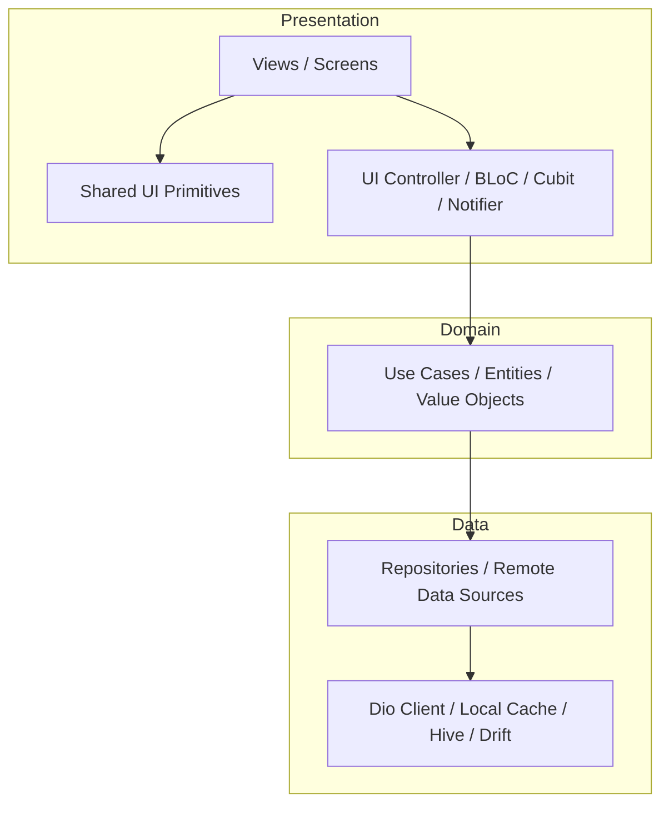

# Template: UI Architecture Plan

> Fillable template for proposing presentation architecture, folder structure, and state patterns during Step 5 & 6.

---

## 1. Executive Summary

- **Feature / Initiative**: [e.g. Redesign Billing Dashboard, Implement Multi-Step Checkout]
- **Target Framework**: [e.g. Next.js 15, Flutter, Jetpack Compose]
- **Material Change Required?**: [Yes / No] *(If Yes, seek user approval before implementation)*

---

## 2. Layered Architecture Design



- **Presentation Layer**: [Describe screens, widgets, BLoC/Cubit state handlers]
- **Domain Layer**: [Describe validation entities, use cases, domain repository contracts]
- **Data Layer**: [Describe repository implementations, DTO models, data sources, database storage]

---

## 3. Directory & Folder Layout Proposal

```text
lib/
├── core/                       # Global infrastructure & theme tokens
│   ├── network/                # Dio client, interceptors, SSL pinning
│   ├── theme/                  # app_colors.dart, app_theme.dart, typography
│   └── errors/                 # failures.dart, exceptions.dart
├── shared/                     # Reusable widgets, custom painters, animations
│   ├── widgets/                # app_button.dart, app_card.dart, app_text_field.dart
│   └── layouts/                # responsive_layout.dart
└── features/                   # Feature-first domain modules
    └── [feature-name]/
        ├── data/               # models, datasources, repository implementations
        ├── domain/             # entities, repository interfaces, usecases
        └── presentation/       # screens, widgets, bloc / cubit / state
```

---

## 4. State Management Strategy

| State Tier | Scope | Mechanism / Tool | Justification |
|---|---|---|---|
| **Local / Ephemeral** | Widget | `StatefulWidget` / `ValueNotifier` | UI toggles, text input focus |
| **Feature State** | Single Flow | BLoC / Cubit / Riverpod Notifier | Predictable business logic & validation |
| **Repository Cache** | Remote Data | Repository pattern + Local DB | Offline persistence & sync |
| **Global State** | App-wide | BLoC / Riverpod Provider | User session, auth token, theme mode |

---

## 5. Shared Component Reuse & Primitives

- **Existing Components Reused**: `[e.g. Button, Input, Modal, Badge]`
- **New Shared Components Created**: `[e.g. StatusTimeline, MetricCard]`
- **Deprecations / Refactors**: `[List any components being replaced]`

---

## 6. Material Change & Risk Assessment

- [ ] Does this add a new external dependency? `[Specify library and size]`
- [ ] Does this change public component APIs or break existing callers?
- [ ] Does this alter global routing or database schemas?

> **User Approval Status**: [Pending User Review / Approved by User / Not Required (Routine)]

