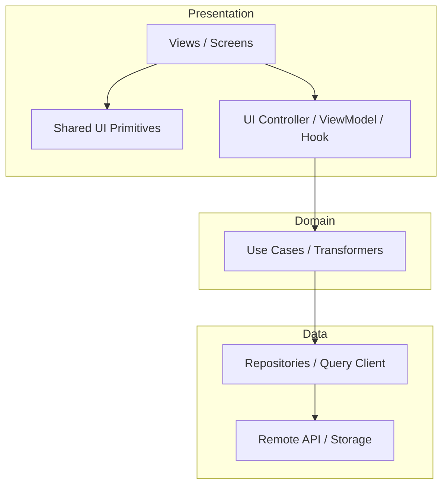

# Template: UI Architecture Plan

> Fillable template for proposing presentation architecture, folder structure, and state patterns during Step 5 & 6.

---

## 1. Executive Summary

- **Feature / Initiative**: [e.g. Redesign Billing Dashboard, Implement Multi-Step Checkout]
- **Target Framework**: [e.g. Next.js 15, Flutter, Jetpack Compose]
- **Material Change Required?**: [Yes / No] *(If Yes, seek user approval before implementation)*

---

## 2. Layered Architecture Design



- **Presentation Layer**: [Describe components, controllers, views]
- **Domain Layer**: [Describe validation rules, business logic entities]
- **Data Layer**: [Describe repositories, DTO mappers, API integration]

---

## 3. Directory & Folder Layout Proposal

```text
src/ (or lib/)
├── core/
│   ├── designsystem/           # [Tokens & Primitives]
│   └── network/                # [API Clients]
├── features/
│   └── [feature-name]/
│       ├── components/         # [Sub-widgets]
│       ├── hooks/              # [Controllers / ViewModels]
│       ├── [FeatureScreen]     # [Main View]
│       └── types.ts            # [Data contracts]
```

---

## 4. State Management Strategy

| State Tier | Scope | Mechanism / Tool | Justification |
|---|---|---|---|
| **Local / Ephemeral** | Component | `useState` / `remember` | UI toggles, text input values |
| **Feature State** | Single Flow | Custom Hook / ViewModel / Cubit | Multi-step wizard state |
| **Server / Cache** | Remote Data | TanStack Query / Repository cache | Auto-caching, retry, deduplication |
| **Global State** | App-wide | Zustand / Riverpod / Store | User session, active theme |

---

## 5. Shared Component Reuse & Primitives

- **Existing Components Reused**: `[e.g. Button, Input, Modal, Badge]`
- **New Shared Components Created**: `[e.g. StatusTimeline, MetricCard]`
- **Deprecations / Refactors**: `[List any components being replaced]`

---

## 6. Material Change & Risk Assessment

- [ ] Does this add a new external dependency? `[Specify library and size]`
- [ ] Does this change public component APIs or break existing callers?
- [ ] Does this alter global routing or database schemas?

> **User Approval Status**: [Pending User Review / Approved by User / Not Required (Routine)]
