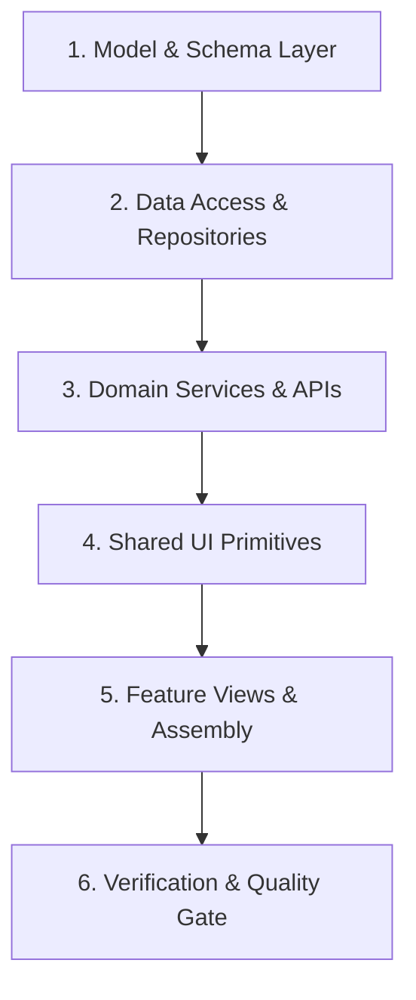

# Workflow: End-to-End Feature Build

> **Step-by-step full-stack implementation lifecycle from models to UI views.**

Follow this workflow when executing `/human-ui build` or constructing a new full-stack feature.

---

## The 6-Stage Build Lifecycle

### Stage 1: Data Model & Schema Definition
1. Define database entities or schemas (SQL migration, Prisma schema, or TypeORM entities).
2. Ensure nullable fields for expand-and-contract safety.
3. Define strict TypeScript interfaces, Dart models, or Kotlin data classes.

### Stage 2: Data Access & Repositories
1. Implement queries with parameterized statements to prevent SQL injection.
2. Add pagination support (`cursor`, `limit`).
3. Optimize queries to prevent N+1 queries using joins or batch fetching.

### Stage 3: Domain Services & API Controllers
1. Encapsulate business logic in pure, testable service functions.
2. Validate incoming controller inputs using runtime validation schemas (Zod/Pydantic).
3. Return RFC 7807 compliant error payloads.

### Stage 4: Shared UI Primitives
1. Inspect `components/` for existing buttons, inputs, modals, and typography primitives.
2. Build any missing primitives with focus rings, hover, disabled, and loading states.
3. Follow the 8pt spatial grid and semantic design tokens.

### Stage 5: Feature Views & UI Assembly
1. Assemble the screen using unidirectional data flow (UDF).
2. Isolate volatile state (inputs, search filters).
3. Handle all 4 UI states: Loading skeleton, Empty state, Error banner, Success view.
4. Verify responsive reflow on mobile (375px) and desktop (1280px).

### Stage 6: Verification & Quality Gate
1. Execute unit and component tests.
2. Verify against the 13 quality gates in [`../quality/engineering-quality-gates.md`](../quality/engineering-quality-gates.md).
3. Report results with changed files and test outputs.

