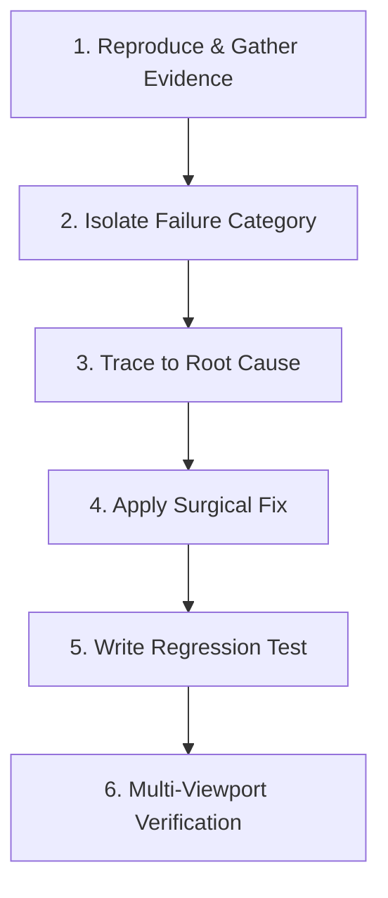

# Workflow: UI Debugging & Defect Resolution

> Systematic, evidence-based diagnostic workflow for reproducing, isolating, repairing, and regression-testing UI bugs.

---

## 1. Purpose

Guesswork debugging—randomly tweaking CSS classes, adding arbitrary `setTimeout` delays, or scattering speculative `if` conditions—often introduces secondary regressions while failing to fix the root cause.

This workflow defines a scientific, reproducible method for diagnosing and resolving UI defects.

---

## 2. The 6-Stage Diagnostic & Repair Sequence

### Stage 1: Reproduce & Gather Evidence
1. Recreate the bug reliably under controlled conditions:
   - What viewport width was active?
   - What platform and input mode (touch vs mouse)?
   - What was the exact sequence of user actions preceding the defect?
2. Capture raw diagnostic evidence:
   - Console logs, stack traces, and uncaught exception messages.
   - Inspect element bounding boxes using browser/platform inspector tools.

### Stage 2: Isolate Failure Category
Cross-reference against the Top 10 recurring UI bug categories in [Bug Prevention](../quality/bug-prevention.md):
- **Layout Overflow**: Flex container lacking `min-w-0`, unconstrained column, long unbroken string.
- **Null / Undefined Crash**: Accessing nested property on asynchronous data before fetch completes.
- **Race Condition / Double Submit**: User rapid-tapping button, missing `disabled={isLoading}` lock.
- **Z-Index / Clipping Trap**: Parent container has `overflow: hidden`, clipping floating dropdown.
- **Sticky Mobile Hover**: CSS `:hover` rule active on touchscreen devices.

### Stage 3: Trace to Root Cause
1. Inspect the source file and git history: When was this code last modified?
2. Formulate a specific hypothesis: *"The container overflows because the child flex item defaults to `min-width: auto`, preventing `text-overflow: ellipsis` from applying."*

### Stage 4: Apply Surgical Fix
1. Apply the minimal necessary code modification.
2. Adhere to [Change Control](../core/change-control.md): Do not rewrite unrelated methods or reformat the entire file.

### Stage 5: Write an Automated Regression Test
1. Author an automated test that mirrors the original reproduction steps.
2. Verify that the test fails on unmodified code and passes with the surgical fix.

### Stage 6: Multi-Viewport Verification & Report
1. Verify the fix across mobile (375px), tablet (768px), and desktop (1280px).
2. Report the root cause and resolution using the [Bug Report Template](../templates/bug-report.md).

---

## 3. Related Documentation

- Master Instructions: [../AGENTS.md](../AGENTS.md)
- Bug Prevention: [../quality/bug-prevention.md](../quality/bug-prevention.md)
- Regression Prevention: [../quality/regression-prevention.md](../quality/regression-prevention.md)
- Change Control: [../core/change-control.md](../core/change-control.md)
- Bug Report Template: [../templates/bug-report.md](../templates/bug-report.md)

