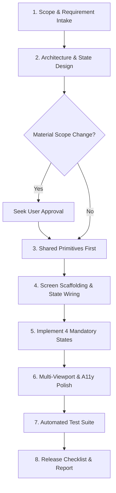

# Workflow: New Feature Implementation

> Step-by-step execution guide for taking a major feature or multi-screen flow from requirement to verified production release.

---

## 1. Purpose

Implementing complex features across multiple screens requires systematic coordination between design tokens, shared primitives, state controllers, and API contracts.

This workflow defines the standard execution sequence for feature development.

---

## 2. Step-by-Step Feature Implementation Lifecycle

### Step 1: Scope & Requirement Intake
1. Analyze user prompt, feature specification, or wireframes.
2. Complete the [Project Brief](../templates/project-brief.md) if starting a large initiative.
3. Identify non-negotiable constraints versus flexible suggestions.

### Step 2: Architecture & State Design
1. Map out the presentation layer, business logic layer, and data repository boundaries.
2. Determine state tiers (local ephemeral, feature state, global app state, server query cache).
3. Draft the technical proposal using the [Architecture Plan Template](../templates/architecture-plan.md).
4. If the feature introduces new external libraries or alters global routing, seek developer approval before writing code.

### Step 3: Shared Primitives & Foundations First
1. Never build complex screens before establishing primitives.
2. Create or adapt required design tokens (colors, typography, spacing).
3. Build or update shared atomic components (`Button`, `TextField`, `Card`, `Badge`) ensuring all 7 states are implemented.

### Step 4: Screen Scaffolding & State Wiring
1. Assemble view containers with responsive layout primitives (flex, grid).
2. Wire presentational components to controllers, ViewModels, or custom hooks.
3. Enforce unidirectional data flow: pass state snapshots down; emit event callbacks up.

### Step 5: Implement the 4 Mandatory UI States
1. **Loading State**: Skeletons or spinners matching the geometry of final content.
2. **Empty State**: Clear explanation, icon, and actionable primary button.
3. **Error State**: User-friendly message and a retry button.
4. **Success State**: Populated happy path with proper text clamping guards.

### Step 6: Multi-Viewport & Accessibility Polish
1. Test viewports: 375px (mobile), 768px (tablet), 1280px+ (desktop).
2. Ensure all touch targets are ≥ 44x44pt (iOS) or ≥ 48x48dp (Android).
3. Verify that all text meets WCAG AA contrast (≥ 4.5:1).
4. Verify keyboard navigation and screen reader semantics.

### Step 7: Automated Testing & Verification
1. Run existing test suites.
2. Write unit tests for business logic, transformers, and validation routines.
3. Write component/widget tests for the feature covering all 4 UI states.
4. Execute the [UI Review Checklist](../quality/ui-review.md).

### Step 8: Pre-Flight Review & Completion Report
1. Audit against the [8-Point Release Checklist](../quality/release-checklist.md).
2. Generate the final [Quality Report](../templates/quality-report.md).
3. Clean up any temporary checkpoint files (`AI_TASK_STATE.md`).

---

## 3. Related Documentation

- Master Instructions: [../AGENTS.md](../AGENTS.md)
- Universal Engineering Workflow: [../core/engineering-workflow.md](../core/engineering-workflow.md)
- Shared Component Rules: [../components/shared-component-rules.md](../components/shared-component-rules.md)
- UI Review Checklist: [../quality/ui-review.md](../quality/ui-review.md)
- Release Checklist: [../quality/release-checklist.md](../quality/release-checklist.md)

