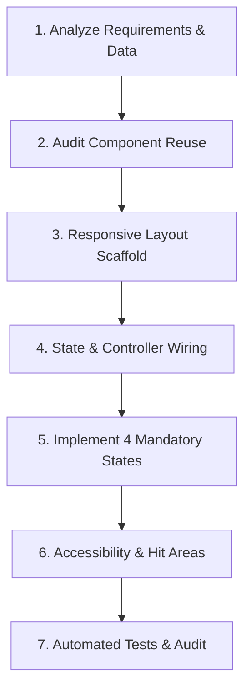

# Workflow: Implementing a New Page or Screen

> Step-by-step execution guide for taking a new screen or view from requirement to verified production code.

---

## 1. Purpose

Adding a new screen haphazardly leads to duplicated logic, unhandled loading states, and layout overflow. 

This workflow defines the standard sequence for building robust, accessible pages.

---

## 2. Step-by-Step Implementation Sequence

### Step 1: Analyze Requirements & Data Needs
1. Read the feature spec or user prompt.
2. Identify the data models required, API endpoints involved, and possible edge cases.
3. Formulate the state management strategy (local vs server query cache).

### Step 2: Audit Component Reuse
1. Inspect `components/` or `core/designsystem/`.
2. Reuse existing buttons, inputs, dialogs, badges, and avatars.
3. If a novel UI pattern is needed, determine whether it should be local to this feature or promoted to a shared primitive.

### Step 3: Responsive Layout Scaffolding
1. Build the screen container structure:
   - Ensure header with title and breadcrumb/back navigation.
   - Constrain content with max-width container centered on desktop (`max-w-7xl mx-auto`).
   - Add appropriate safe area padding for mobile insets.
2. Ensure columns stack cleanly into a single vertical column on mobile screens (< 768px).

### Step 4: State & Controller Wiring
1. Connect the view to its ViewModel, custom hook, or state controller.
2. Implement unidirectional data flow: pass data to presentational sub-widgets, wire user interaction callbacks to the controller.
3. Keep pure business logic out of the template / render function.

### Step 5: Implement the 4 Mandatory UI States
Never consider a page complete without all four states:
1. **Loading State**: Display skeleton loaders matching the final page geometry.
2. **Empty State**: Meaningful explanation, icon, and CTA when no records exist.
3. **Error State**: User-friendly error message with a "Retry" button.
4. **Success State**: Populated view with proper data formatting and line truncation guards.

### Step 6: Accessibility & Interaction Polish
1. Validate keyboard tab sequence across all interactive fields.
2. Ensure touch targets are at least 44x44pt on mobile.
3. Verify text contrast ratios meet 4.5:1 WCAG AA.

### Step 7: Automated Tests & Verification
1. Run existing test suites.
2. Write component/widget tests for the new screen covering the 4 states and critical user interactions.
3. Execute the [UI Review Checklist](../quality/ui-review.md).

---

## 3. Related Documentation

- Master Instructions: [../AGENTS.md](../AGENTS.md)
- Development Workflow: [../core/development-workflow.md](../core/development-workflow.md)
- UI Review Checklist: [../quality/ui-review.md](../quality/ui-review.md)
- Testing Standards: [../quality/testing.md](../quality/testing.md)

