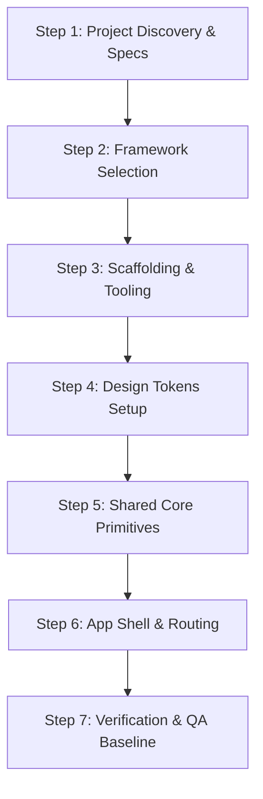

# Workflow: New Project Setup

> Step-by-step execution guide for establishing a new UI engineering project from scratch.

---

## 1. Purpose

Starting a new UI project without systematic foundations results in early architectural drift, ad-hoc styling, and technical debt. 

This workflow guides an AI agent or engineer through setting up a production-ready UI codebase.

---

## 2. Step-by-Step Workflow

### Step 1: Project Discovery & Requirements
1. Define the application domain, target audience, brand tone, and supported platforms.
2. Complete the standardized [Project Brief Template](../templates/project-brief.md).

### Step 2: Framework & Tooling Selection
1. Consult the [Framework Selection Matrix](../frameworks/framework-selection.md).
2. Confirm language, build tool (Vite, Next.js, Gradle, Xcode, Flutter), and package manager.

### Step 3: Scaffolding & Strict Tooling Setup
1. Initialize the project repository with standard directory conventions (refer to [Folder Structure](../core/folder-structure.md)).
2. Configure strict type-checking (`tsconfig.json` with `"strict": true`, or Dart strong mode).
3. Setup code formatters and linters (Prettier, ESLint, `analysis_options.yaml`, ktlint).

### Step 4: Design Tokens & Base Theme Setup
1. Establish the design token system:
   - Neutrals, primary brand colors, semantic status colors (refer to [Color System](../design/color-system.md)).
   - Typographic scale, line-heights, and font families (refer to [Typography](../design/typography.md)).
   - Spatial 4pt/8pt grid (refer to [Spacing](../design/spacing.md)).
2. Complete the [Design System Template](../templates/design-system.md).

### Step 5: Shared Core Primitives
Construct the foundational reusable components before building any business screens:
- `Button` (Primary, Secondary, Ghost, Destructive) with loading states.
- `TextField` with accessible labels, errors, and focus rings.
- `Card` container with outlined and elevated variants.
- `Typography` primitives (`Heading`, `Text`, `Badge`).

### Step 6: Navigation Shell & Root Layout
1. Implement the responsive navigation shell (Sidebar on desktop, Bottom Nav on mobile).
2. Wire up the routing system and global error boundaries.

### Step 7: Verification & QA Baseline
1. Verify clean production build (`npm run build`, `flutter build`).
2. Run initial test suite and accessibility audit.
3. Generate the baseline [Quality Report](../templates/quality-report.md).

---

## 3. Related Documentation

- Master Instructions: [../AGENTS.md](../AGENTS.md)
- Project Discovery: [../core/project-discovery.md](../core/project-discovery.md)
- Framework Selection: [../frameworks/framework-selection.md](../frameworks/framework-selection.md)
- Project Brief Template: [../templates/project-brief.md](../templates/project-brief.md)
- Release Checklist: [../quality/release-checklist.md](../quality/release-checklist.md)
