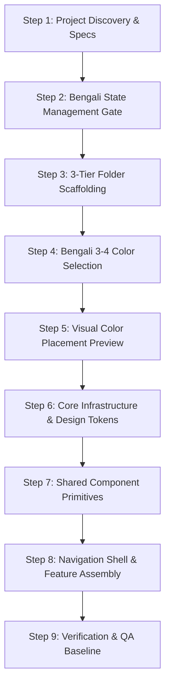

# Workflow: New Flutter Project Setup

> **Permission-First, Human-Centered Execution Guide** for establishing a new production-ready Flutter codebase from scratch.

Starting a Flutter project without systematic foundations results in early architectural drift, ad-hoc styling, and technical debt. This workflow enforces Bengali permission gates for all major architectural and color decisions, followed by scaffolding the mandatory `lib/core/`, `lib/shared/`, and `lib/features/` structure.

---

## 1. End-to-End Setup Sequence



---

## 2. Detailed Execution Steps

### Step 1: Project Discovery & Requirements
1. Define the Flutter application domain, target audience, brand tone, and supported platforms (Android, iOS, Web, macOS, Windows, Linux).
2. Complete the standardized [Project Brief Template](../templates/project-brief.md).

### Step 2: State Management & Architecture Permission Gate (Mandatory Bengali)
1. The agent must **NOT** pick state management independently.
2. Ask the user in Bengali, following the 7-step permission protocol:
   ```text
   আপনার Flutter প্রজেক্টে State Management নির্বাচন করতে হবে।
   অপশনসমূহ: BLoC/Cubit, Riverpod, Provider, GetX।
   সুপারিশ ও কারণ দর্শিয়ে অনুমতি চান এবং উত্তরের জন্য অপেক্ষা করুন।
   ```
3. Wait for explicit approval before proceeding.

### Step 3: Mandatory 3-Tier Folder Scaffolding
Scaffold the required top-level architecture:
```text
lib/
├── core/       # Config, network, errors, storage, theme tokens
├── shared/     # widgets/, custom/, animations/, layouts/
└── features/   # Independent feature packages
```
*(Refer to [Project Structure Reference](../skills/human-flutter/references/project-structure.md)).*

### Step 4: Mandatory 3–4 Color Selection (Bengali Prompt)
1. Ask the user in Bengali to choose 3 or 4 primary colors:
   ```text
   আপনার অ্যাপ্লিকেশনের জন্য ৩টি অথবা ৪টি মূল রং (HEX কোডসহ) নির্বাচন করুন।
   এই রংগুলোর ভিত্তিতে সম্পূর্ণ অ্যাপ্লিকেশনের Color System তৈরি করা হবে।
   ```
2. Wait for user input. Never invent arbitrary brand colors.

### Step 5: Visual Color Placement Preview Board
1. Before authoring theme code, display the 12-component visual color board mapping the colors to:
   - App background, App bar, Navigation bar, Primary/Secondary buttons, Cards, Input fields, Text/headings, Icons, Borders/dividers, Selection states, and Status states.
2. Request approval in Bengali and wait.
*(Refer to [Color Preview Reference](../skills/human-flutter/references/color-preview.md)).*

### Step 6: Core Infrastructure & Design Tokens
1. Once the color preview is approved, implement:
   - `lib/core/theme/app_colors.dart` (ColorScheme + ThemeExtension)
   - `lib/core/theme/app_theme.dart` (Light and Dark ThemeData)
   - `lib/core/theme/app_typography.dart`, `app_spacing.dart`, `app_radius.dart`
2. Configure strict type-checking in `analysis_options.yaml`.

### Step 7: Shared Component Primitives in `lib/shared/`
Construct foundational primitives before building business screens:
- `lib/shared/widgets/buttons/app_button.dart` (Primary, Secondary, Outline, Destructive)
- `lib/shared/widgets/cards/app_card.dart`
- `lib/shared/widgets/inputs/app_text_field.dart`
- `lib/shared/widgets/loaders/app_shimmer.dart`

### Step 8: Navigation Shell & First Feature Module
1. Configure declarative routing (`go_router`) in `lib/core/routing/`.
2. Implement adaptive navigation (NavigationBar for mobile, NavigationRail for tablet/desktop).
3. Build the first feature inside `lib/features/<first_feature>/` (`presentation/`, `data/`, `domain/`).

### Step 9: Verification & QA Baseline
1. Execute `dart analyze` (0 errors, 0 warnings).
2. Execute `flutter test` for all shared components and initial feature.
3. Verify zero RenderFlex overflows and WCAG AA contrast compliance.

---

## 3. Related Documentation

- Master Instructions: [../AGENTS.md](../AGENTS.md)
- Permission System Reference: [../skills/human-flutter/references/permission-system.md](../skills/human-flutter/references/permission-system.md)
- Project Structure Reference: [../skills/human-flutter/references/project-structure.md](../skills/human-flutter/references/project-structure.md)
- Color Preview Reference: [../skills/human-flutter/references/color-preview.md](../skills/human-flutter/references/color-preview.md)
- Canonical Flutter Skill: [../skills/human-flutter/SKILL.md](../skills/human-flutter/SKILL.md)
