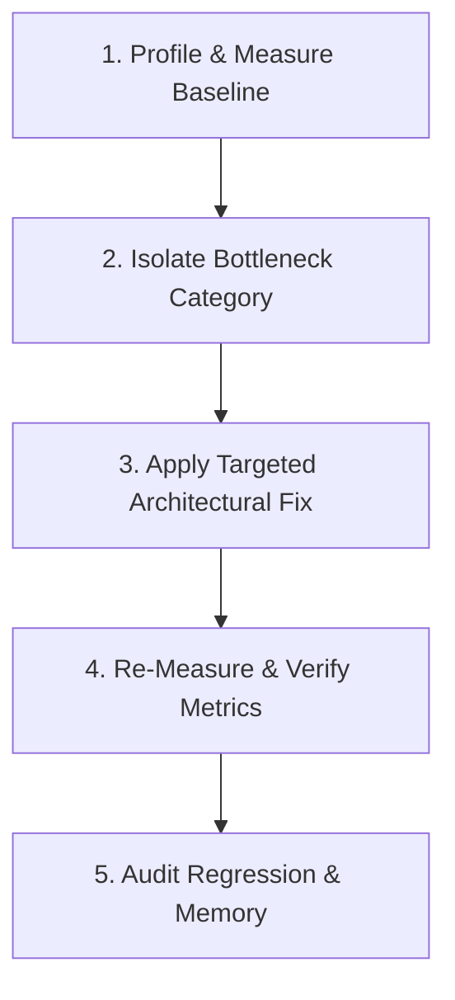

# Workflow: Diagnosing & Fixing Performance Bottlenecks

> Step-by-step procedure for profiling, isolating, resolving, and verifying UI performance issues.

---

## 1. Purpose

Attempting to fix performance through guesswork—such as randomly adding `useMemo` or `React.memo` everywhere—often degrades performance and obfuscates code. 

This workflow provides a scientific, evidence-based approach to resolving UI jank, frame drops, and memory leaks.

---

## 2. Step-by-Step Diagnostic & Resolution Loop



### Step 1: Profile & Measure the Baseline
Never optimize without measurable data:
1. Record a trace using profiler tools:
   - **Web**: Chrome DevTools Performance tab, React Developer Tools Profiler.
   - **Flutter**: Flutter DevTools Performance and CPU profiler.
   - **Android**: Android Studio CPU & Memory Profiler.
   - **iOS**: Xcode Instruments (Time Profiler, Allocations).
2. Record concrete baseline numbers:
   - Average FPS during scroll / interaction.
   - Component render duration (in milliseconds).
   - Heap memory allocation (MB) over time.

### Step 2: Isolate the Bottleneck Category
Determine the exact cause:
- **Excessive Re-renders**: A parent component re-renders on every keystroke, forcing 200 child components to evaluate.
- **Unbounded List Rendering**: Rendering 2,000 DOM nodes or widgets simultaneously without virtualization.
- **Main Thread CPU Blocking**: Heavy sorting, regex, or JSON parsing executing synchronously during animation.
- **Memory Leak**: Event listeners or controllers accumulating without disposal.
- **Layout Thrashing**: Reading DOM layout geometry (`offsetHeight`) immediately followed by writing styling in a loop.

### Step 3: Apply the Targeted Architectural Fix

| Diagnosed Cause | Prescribed Engineering Fix |
|---|---|
| **Excessive Rebuilds** | Isolate volatile state into local leaf widgets; use selectors or `const` constructors. |
| **Long List Jank** | Virtualize the collection using `ListView.builder` or `CustomScrollView` with `SliverList`. |
| **Heavy Computation** | Move work off the UI thread via Dart background isolates (`compute()`). |
| **Memory Leak** | Add missing cleanup in `State.dispose()`, cancel `StreamSubscription`s, dispose controllers. |
| **Unbounded Constraints** | Wrap dynamic children in `Expanded` or `Flexible` to prevent `RenderFlex` exceptions. |

### Step 4: Re-Measure & Verify Metrics
1. Re-run the identical profiling trace under the same device conditions.
2. Verify that frame times dropped below the 16.6ms (60fps) or 8.3ms (120fps) threshold.
3. Confirm that heap memory stabilizes and returns to baseline after view dismissal.

### Step 5: Report Results Transparently
Document the before-and-after metrics in the PR or report:
```text
Performance Audit Results:
- Baseline Scroll FPS: 28 fps (severe frame drops during list scrolling)
- Post-Fix Scroll FPS: 60 fps (steady 60fps achieved via list virtualization)
- Heap Allocation: Reduced from 142MB to 38MB
```

---

## 3. Related Documentation

- Master Instructions: [../AGENTS.md](../AGENTS.md)
- Performance Engineering: [../engineering/performance.md](../engineering/performance.md)
- Memory Management: [../engineering/memory-management.md](../engineering/memory-management.md)
- Performance Audit Checklist: [../quality/performance-audit.md](../quality/performance-audit.md)

