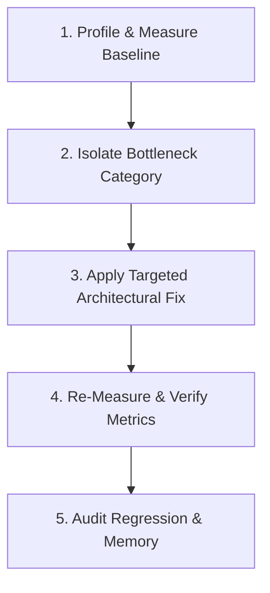

# Workflow: Diagnosing & Fixing Performance Bottlenecks

> Step-by-step procedure for profiling, isolating, resolving, and verifying UI performance issues.

---

## 1. Purpose

Attempting to fix performance through guesswork—such as blindly wrapping widgets or guessing rebuild causes without profiling—often degrades performance and obfuscates code. 

This workflow provides a scientific, evidence-based approach to resolving Flutter UI jank, frame drops, and memory leaks.

---

## 2. Step-by-Step Diagnostic & Resolution Loop



### Step 1: Profile & Measure the Baseline
Never optimize without measurable data:
1. Record a trace using **Flutter DevTools**:
   - Performance view (UI thread time vs Raster thread time, frame budget bar chart).
   - CPU Profiler (trace expensive function calls).
   - Memory allocation view (heap snapshot diffs to detect un-disposed objects).
2. Record concrete baseline numbers:
   - Average FPS during scroll / interaction (target: 60fps / 120fps).
   - Widget build duration (in milliseconds, frame budget ≤ 16.6ms or ≤ 8.3ms).
   - Heap memory allocation (MB) over time.

### Step 2: Isolate the Bottleneck Category
Determine the exact cause:
- **Excessive Rebuilds**: A parent state change triggers full-screen rebuilds. Wrap static widgets in `const` and use fine-grained selectors (`context.select`, `buildWhen`).
- **Unbounded List Rendering**: Rendering hundreds of items without virtualization. Use `ListView.builder` or `GridView.builder`.
- **Main Thread CPU Blocking**: Heavy sorting, regex, or JSON decoding executing synchronously during animation. Offload to background isolates via `compute()`.
- **Memory Leak**: `TextEditingController`, `AnimationController`, or `StreamSubscription` accumulating without `dispose()`.
- **Raster Thread Overload**: Heavy runtime blur (`BackdropFilter`) or un-cached oversized image decoding on the raster thread.

### Step 3: Apply the Targeted Architectural Fix

| Diagnosed Cause | Prescribed Engineering Fix |
|---|---|
| **Excessive Rebuilds** | Isolate volatile state into local leaf widgets; use selectors or `const` constructors. |
| **Long List Jank** | Virtualize the collection using `ListView.builder` or `CustomScrollView` with `SliverList`. |
| **Heavy Computation** | Move work off the UI thread via Dart background isolates (`compute()`). |
| **Memory Leak** | Add missing cleanup in `State.dispose()`, cancel `StreamSubscription`s, dispose controllers. |
| **Unbounded Constraints** | Wrap dynamic children in `Expanded` or `Flexible` to prevent `RenderFlex` exceptions. |

### Step 4: Re-Measure & Verify Metrics
1. Re-run the identical profiling trace under the same device conditions.
2. Verify that frame times dropped below the 16.6ms (60fps) or 8.3ms (120fps) threshold.
3. Confirm that heap memory stabilizes and returns to baseline after view dismissal.

### Step 5: Report Results Transparently
Document the before-and-after metrics in the PR or report:
```text
Performance Audit Results:
- Baseline Scroll FPS: 28 fps (severe frame drops during list scrolling)
- Post-Fix Scroll FPS: 60 fps (steady 60fps achieved via list virtualization)
- Heap Allocation: Reduced from 142MB to 38MB
```

---

## 3. Related Documentation

- Master Instructions: [../AGENTS.md](../AGENTS.md)
- Performance Engineering: [../engineering/performance.md](../engineering/performance.md)
- Memory Management: [../engineering/memory-management.md](../engineering/memory-management.md)
- Performance Audit Checklist: [../quality/performance-audit.md](../quality/performance-audit.md)

