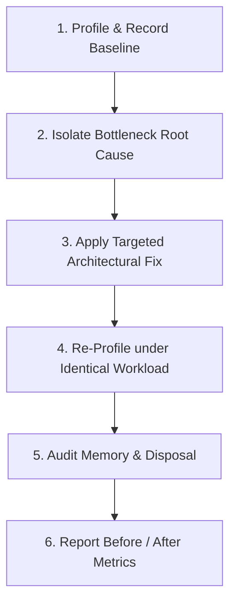

# Workflow: Performance Optimization & Profiling

> Step-by-step procedure for profiling, diagnosing, resolving, and verifying UI frame drops, slow renders, and memory leaks.

---

## 1. Purpose

Performance optimization must be driven by empirical data and profiling traces, not intuition. Speculatively wrapping components in memoization often degrades performance and clutters code.

This workflow defines an evidence-based performance optimization procedure.

---

## 2. Step-by-Step Optimization Sequence

### Step 1: Profile & Record Quantitative Baseline
1. Never optimize without measured baseline telemetry:
   - **Scroll FPS**: Record frame drop counts during scrolling.
   - **Render Duration**: Measure component evaluation duration (in milliseconds).
   - **Heap Memory**: Record heap allocation (in MB) before and after interaction.
2. Tooling:
   - **Web**: Chrome DevTools Performance & Memory tabs, React DevTools Profiler.
   - **Flutter**: Flutter DevTools Performance and CPU profiler.
   - **Android**: Android Studio CPU / Memory Profiler.
   - **iOS**: Xcode Instruments (Time Profiler, Allocations).

### Step 2: Isolate Bottleneck Category
1. **Excessive Rebuilds**: A parent state change forces hundreds of unchanged child components to re-render.
2. **Unbounded List Rendering**: Instantiating thousands of DOM elements or widgets without virtualization.
3. **Main Thread CPU Blocking**: Heavy data parsing, filtering, or encryption executing synchronously on the UI thread.
4. **Memory Leaks**: Event listeners, timers, controllers, or streams remaining active after view unmount.
5. **Layout Thrashing**: Alternating DOM reads and writes inside tight loops.

### Step 3: Apply Targeted Architectural Fix

| Diagnosed Cause | Prescribed Engineering Fix |
|---|---|
| **Excessive Rebuilds** | Isolate volatile state; use fine-grained selectors (`buildWhen`, `select`); mark static widgets `const`. |
| **Long List Jank** | Virtualize the collection using `ListView.builder`, `GridView.builder`, or `CustomScrollView` with `SliverList`. |
| **CPU Blocking** | Offload heavy JSON parsing or calculation to background isolates via `compute()`. |
| **Memory Leaks** | Override `dispose()` in `StatefulWidget`, cancel `StreamSubscription`s, dispose controllers. |
| **Unbounded Viewports** | Wrap unbounded lists in `Expanded` or constrain heights to eliminate layout exceptions. |

### Step 4: Re-Profile under Identical Workload
1. Re-run the exact profiling trace under the same device conditions.
2. Confirm that frame times remain within the **16.6ms** (60fps) or **8.3ms** (120fps) budget.

### Step 5: Audit Memory Disposal & Leaks
1. Navigate back and forth between screens 5 times.
2. Take a heap snapshot; verify that memory returns to baseline and views are garbage-collected.

### Step 6: Report Empirical Results
Document before-and-after metrics in the PR or task report:
- Baseline vs. Optimized Scroll FPS.
- Component render duration reduction (ms).
- Heap memory stabilization (MB).

---

## 3. Related Documentation

- Master Instructions: [../AGENTS.md](../AGENTS.md)
- Performance Engineering: [../engineering/performance.md](../engineering/performance.md)
- Memory Management: [../engineering/memory-management.md](../engineering/memory-management.md)
- Performance Audit Checklist: [../quality/performance-audit.md](../quality/performance-audit.md)
- Diagnostic Fix Guide: [performance-fix.md](performance-fix.md)

