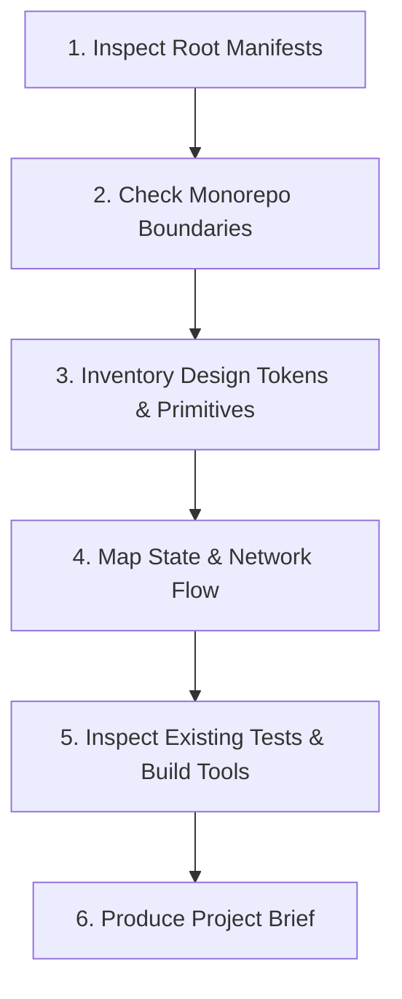

# Workflow: Project Discovery & Codebase Mapping

> Operational workflow for an AI agent to explore, map, and understand an existing software repository before proposing changes.

---

## 1. Purpose

Executing code modifications without discovering the project's ecosystem, package boundaries, existing design systems, and state management patterns results in duplicate components, broken architectures, and style drift.

This workflow guides an agent through an evidence-based codebase discovery pass.

---

## 2. Step-by-Step Discovery Procedure

### Step 1: Inspect Manifests & Dart Constraints
1. Run directory inspection on root files.
2. Locate `pubspec.yaml` and inspect dependencies:
   - Check Flutter SDK constraints (e.g., `sdk: ^3.24.0`).
   - Check state management packages (`flutter_bloc`, `flutter_riverpod`, `provider`).
   - Check networking, routing, and database dependencies (`dio`, `go_router`, `drift`).
   - Inspect `analysis_options.yaml` for strict lint rules.

### Step 2: Monorepo & Multi-Package Boundary Isolation
1. If the project is a Flutter monorepo (Melos) containing `apps/` or `packages/`:
   - Identify which subproject the active task belongs to.
   - Restrict edits strictly to that subpackage's boundaries.
   - Never cross-contaminate dependencies between isolated packages.

### Step 3: Inventory Design Tokens & Shared Primitives
1. Search for color, typography, and spacing tokens in `lib/core/theme/`:
   - `app_colors.dart` (ColorScheme & ThemeExtensions).
   - `app_typography.dart` (TextTheme scales).
   - `app_spacing.dart` (8pt/4pt mathematical grid).
2. Locate shared widget libraries in `lib/shared/widgets/`:
   - Catalog existing buttons, inputs, cards, and dialogs to prevent building duplicates.

### Step 4: Map State Management & Data Flow
1. Identify how asynchronous data is fetched and cached (Dio, Repository pattern, Drift, Isar).
2. Identify how client state is managed (BLoC, Cubit, Riverpod, Provider).
3. Identify routing and navigation libraries (`go_router`, Navigator 2.0).

### Step 5: Inspect Existing Tests & Linters
1. Inspect `pubspec.yaml` test dependencies and `analysis_options.yaml`.
2. Run a baseline test (`flutter test`) and static check (`dart analyze`) to confirm the current health of the codebase.

### Step 6: Produce Project Brief
Summarize findings using the [Project Brief Template](../templates/project-brief.md) before presenting architectural proposals to the user.

---

## 3. Related Documentation

- Master Instructions: [../AGENTS.md](../AGENTS.md)
- Project Discovery Guide: [../core/project-discovery.md](../core/project-discovery.md)
- Anti-Hallucination: [../core/anti-hallucination.md](../core/anti-hallucination.md)
- Project Brief Template: [../templates/project-brief.md](../templates/project-brief.md)

