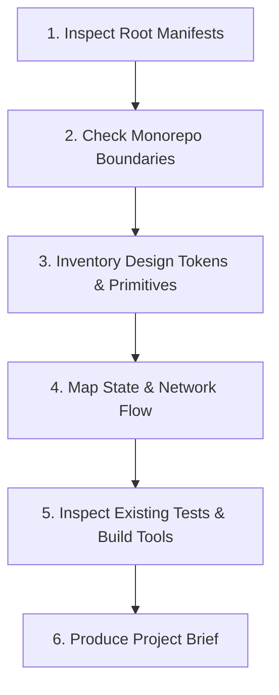

# Workflow: Project Discovery & Codebase Mapping

> Operational workflow for an AI agent to explore, map, and understand an existing software repository before proposing changes.

---

## 1. Purpose

Executing code modifications without discovering the project's ecosystem, package boundaries, existing design systems, and state management patterns results in duplicate components, broken architectures, and style drift.

This workflow guides an agent through an evidence-based codebase discovery pass.

---

## 2. Step-by-Step Discovery Procedure

### Step 1: Inspect Root Manifests & Identify Frameworks
1. Run directory inspection on root files.
2. Locate package manifests and read dependencies:
   - `package.json` -> Check dependencies for React, Next.js, Vue, Angular, React Native, Tailwind, etc.
   - `pubspec.yaml` -> Check Flutter SDK constraints, state management (bloc, riverpod, provider).
   - `build.gradle.kts` / `settings.gradle.kts` -> Check Android Compose, Kotlin version, target SDK.
   - `Package.swift` / `Podfile` -> Check iOS deployment targets and Swift dependencies.

### Step 2: Monorepo & Multi-Package Boundary Isolation
1. If the project contains `apps/` or `packages/`:
   - Identify which subproject the active task belongs to.
   - Restrict edits strictly to that subproject's boundaries.
   - Never cross-contaminate dependencies between isolated packages.

### Step 3: Inventory Design Tokens & Shared Primitives
1. Search for color and typography token definitions:
   - Web: `tailwind.config.*`, `styles/tokens.css`, `theme/`.
   - Flutter: `lib/core/theme/` (`AppColors`, `AppTypography`).
   - Android: `core/designsystem/` (`Color.kt`, `Type.kt`, `Theme.kt`).
   - iOS: `Assets.xcassets`, `Color+Extensions.swift`.
2. Locate shared component libraries (`components/ui/`, `core/widgets/`). Catalog existing buttons, inputs, and modals to prevent building duplicates.

### Step 4: Map State Management & Data Flow
1. Identify how asynchronous server data is fetched and cached (TanStack Query, RTK Query, Repository pattern).
2. Identify how global client state is managed (Zustand, Redux, Pinia, Riverpod, Signals, ViewModel).
3. Identify routing and navigation libraries (App Router, React Router, GoRouter, Jetpack Navigation).

### Step 5: Inspect Existing Tests & Linters
1. Inspect `package.json` scripts or test configurations (`vitest.config.ts`, `analysis_options.yaml`, `build.gradle.kts`).
2. Run a baseline test or static check to confirm the current health of the codebase.

### Step 6: Produce Project Brief
Summarize findings using the [Project Brief Template](../templates/project-brief.md) before presenting architectural proposals to the user.

---

## 3. Related Documentation

- Master Instructions: [../AGENTS.md](../AGENTS.md)
- Project Discovery Guide: [../core/project-discovery.md](../core/project-discovery.md)
- Anti-Hallucination: [../core/anti-hallucination.md](../core/anti-hallucination.md)
- Project Brief Template: [../templates/project-brief.md](../templates/project-brief.md)

