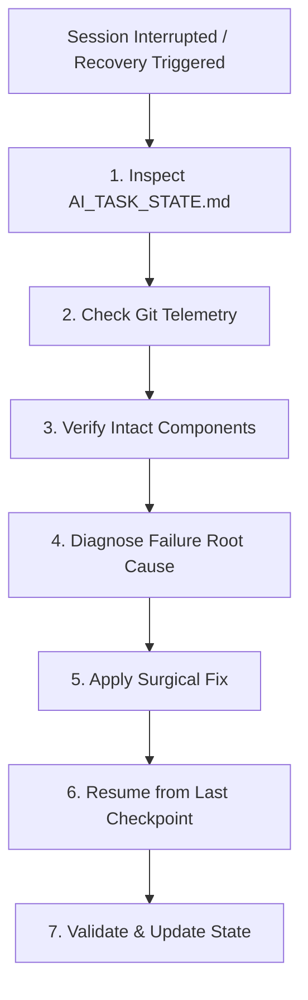

# Workflow: Autonomous Task Recovery

> Actionable execution guide for resuming interrupted sessions, recovering from tool crashes, and diagnosing execution failures.

---

## 1. Purpose

When an agent session crashes, times out, or encounters a non-compiling state, restarting the entire task from scratch wastes time and risks deleting working code.

This workflow guides an agent or engineer through the recovery sequence.

---

## 2. Step-by-Step Recovery Procedure



### Step 1: Inspect `AI_TASK_STATE.md`
1. Check if `AI_TASK_STATE.md` exists in the repository root.
2. Read the recorded task title, completed milestones, and active step.
3. If no state file exists, proceed to Step 2 to reconstruct state from git telemetry.

### Step 2: Check Git Telemetry
Run read-only inspection commands to discover changes:
```bash
git status
git diff --stat
git log -n 5 --oneline
```
- List all modified tracked files and newly created untracked files.

### Step 3: Verify Intact Components
1. Inspect the modified files on disk.
2. Separate fully functioning, verified files from partially written or broken files.
3. **DO NOT run `git reset --hard`**. Preserve all functional work.

### Step 4: Diagnose Failure Root Cause
1. Determine what caused the interruption:
   - Syntax error / unclosed tag.
   - Missing dependency import.
   - Failed test assertion.
   - Context window limit / session disconnection.
2. Formulate the precise fix needed to restore compilability.

### Step 5: Apply Surgical Fix
1. Repair the specific compiler or logic error.
2. Verify that the project compiles cleanly (`npm run build`, `flutter analyze`, etc.).

### Step 6: Resume from Last Verified Checkpoint
1. Re-enter the 14-step engineering workflow at the earliest uncompleted step.
2. Continue implementation without re-writing already completed components.

### Step 7: Validate & Update State
1. Run automated test suites.
2. Update `AI_TASK_STATE.md` to reflect the current milestone.
3. Report the recovery summary and current status to the user.

---

## 3. Related Documentation

- Master Instructions: [../AGENTS.md](../AGENTS.md)
- Recovery Protocol: [../core/recovery-protocol.md](../core/recovery-protocol.md)
- Checkpoint Management: [../core/checkpoint-management.md](../core/checkpoint-management.md)
- Task State Template: [../templates/task-state.md](../templates/task-state.md)
