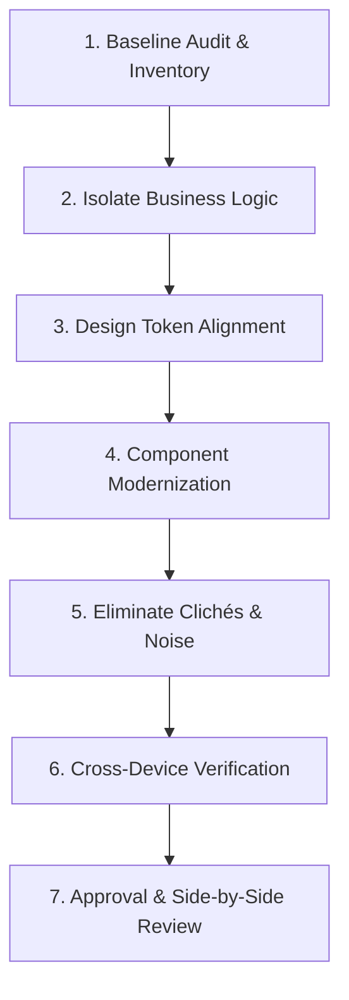

# Workflow: UI Redesign & Modernization

> Step-by-step execution guide for safely modernizing legacy user interfaces without introducing regressions.

---

## 1. Purpose

Redesigning an existing screen or application is high-risk: it is easy to accidentally drop subtle validation logic, break accessibility, or destroy existing user habits. 

This workflow provides a methodical process for executing UI redesigns safely.

---

## 2. Step-by-Step Redesign Sequence

### Step 1: Baseline Audit & State Inventory
1. Capture screenshots or record existing behavior across mobile and desktop.
2. Catalog all user actions, validation rules, error handling flows, and analytics triggers present in the legacy view.
3. Verify that existing automated test suites currently pass before touching any code.

### Step 2: Isolate Business Logic from Presentation
1. Ensure business logic and network calls are decoupled from the legacy markup into ViewModels, custom hooks, or state controllers.
2. Do not rewrite backend contracts or state management solutions during a visual redesign unless explicitly requested.

### Step 3: Design Token Alignment
1. Replace hardcoded hex colors with semantic tokens (`bg-surface`, `text-primary`, `border-default`).
2. Replace arbitrary margins and paddings with the standard 4pt/8pt spatial grid tokens.
3. Standardize font sizes against the 8-tier typographic scale.

### Step 4: Component Modernization
1. Swap legacy ad-hoc HTML elements or widgets for design system primitives (`AppButton`, `AppTextField`, `AppCard`).
2. Implement compound component structures where applicable.
3. Ensure proper loading skeletons, empty states, and error alerts are introduced if previously missing.

### Step 5: Eliminate AI Clichés & Decorative Noise
1. Remove gratuitous neon drop shadows, arbitrary glow borders, and ungrounded glassmorphism.
2. Eliminate redundant card containers; use whitespace and clean alignment to establish visual hierarchy.

### Step 6: Cross-Device & Accessibility Verification
1. Verify responsiveness at 375px, 768px, and 1280px+.
2. Verify contrast compliance in both Light and Dark modes.
3. Test full keyboard navigation and screen reader semantics.

### Step 7: Side-by-Side Review & Verification
1. Compare the modernized UI with the baseline inventory from Step 1 to guarantee zero feature regression.
2. Run test suites and report the results.

---

## 3. Related Documentation

- Master Instructions: [../AGENTS.md](../AGENTS.md)
- Design Philosophy: [../design/design-philosophy.md](../design/design-philosophy.md)
- Human Design Rules: [../design/human-design-rules.md](../design/human-design-rules.md)
- UI Review Checklist: [../quality/ui-review.md](../quality/ui-review.md)
- Release Checklist: [../quality/release-checklist.md](../quality/release-checklist.md)
