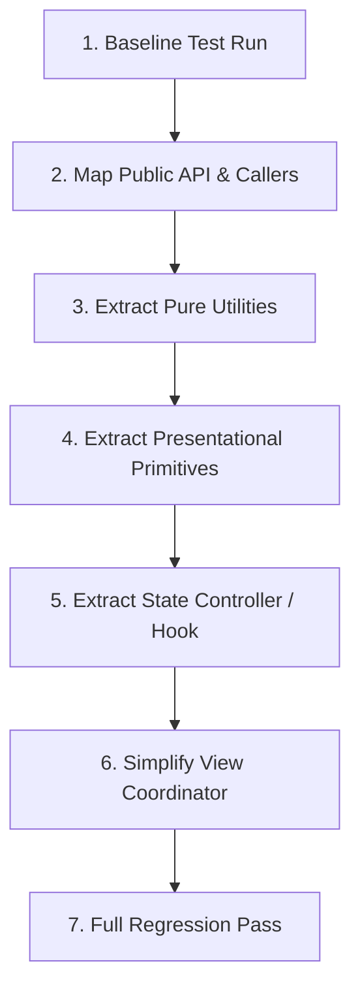

# Workflow: Safe UI Refactoring

> Step-by-step procedure for decomposing monolithic components, improving code structure, and modernizing state logic without regressions.

---

## 1. Purpose

Refactoring UI code carries high risk: it is easy to accidentally drop subtle validation rules, break keyboard focus handlers, or induce layout shifts.

This workflow provides an incremental, gated procedure for safe refactoring.

---

## 2. Step-by-Step Refactoring Sequence

### Step 1: Baseline Test Run & Inventory
1. Run all existing tests and static analysis.
2. Confirm that the codebase currently passes. If baseline tests fail, resolve them before refactoring.
3. Capture visual baseline screenshots across mobile and desktop.

### Step 2: Map Public API & Consumers
1. Search the repository for all consumers of the component being refactored.
2. Note all prop names, types, and default values.
3. Commit to maintaining backward compatibility of all public props.

### Step 3: Extract Pure Utilities & Data Transformers
1. Locate pure functions embedded inside the component (date formatters, currency math, regex validators).
2. Extract them into a dedicated utility file (`utils/formatting.ts`).
3. Add co-located unit tests and verify they pass.

### Step 4: Extract Presentational Sub-Widgets
1. Locate repeated or distinct visual subtrees (table headers, list items, badge clusters).
2. Extract them into private, presentational sub-components.
3. Verify that the parent view still renders identically.

### Step 5: Extract State Logic into ViewModel or Hook
1. Move data fetching, mutation handlers, and complex state into a custom hook (`useFeatureFlow()`), ViewModel, or Cubit.
2. The view should now receive state snapshots and emit callbacks.

### Step 6: Simplify the Main View Coordinator
1. Verify that the main component file is now under 200 lines and acts purely as a declarative coordinator.
2. Clean up dead imports and unused variables.

### Step 7: Full Regression Pass & Verification
1. Re-run all unit, component, and integration tests.
2. Compare before-and-after visual rendering across 375px, 768px, and 1280px viewports.
3. Run the [8-Point Release Checklist](../quality/release-checklist.md).

---

## 3. Related Documentation

- Master Instructions: [../AGENTS.md](../AGENTS.md)
- Change Control Standards: [../core/change-control.md](../core/change-control.md)
- Clean Code Standards: [../engineering/clean-code.md](../engineering/clean-code.md)
- Regression Prevention: [../quality/regression-prevention.md](../quality/regression-prevention.md)

