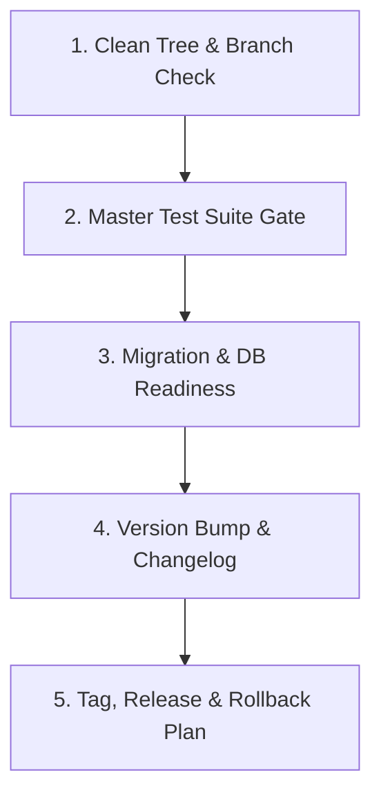

# Workflow: Production Release & Deployment

> **Step-by-step pre-flight verification, semantic release, and deployment protocol.**

Follow this workflow when executing `/human-ui release` or preparing a production release candidate.

---

## The 5-Stage Release Lifecycle

### Stage 1: Clean Working Tree Check
1. Execute `git status --porcelain`.
2. Confirm working tree has zero unstaged or untracked changes.
3. Confirm active branch is `main` or release branch.

### Stage 2: Master Test Suite Gate
1. Execute formatting and lint check (`npm run lint`, `dart analyze`).
2. Execute full automated test suite (`npm test`, `pytest`, `flutter test`).
3. Execute production build (`npm run build`, `flutter build`).
4. **Golden Rule**: If any check fails, halt the release immediately.

### Stage 3: Database & Migration Readiness
1. Verify that database migrations are backward-compatible (Expand & Contract pattern).
2. Confirm new columns are nullable or have defaults.
3. Verify that zero-downtime concurrent indexing is applied.

### Stage 4: Version Bump & Changelog Update
1. Determine semantic version increment (MAJOR, MINOR, PATCH).
2. Update version in `package.json`, `pubspec.yaml`, or project manifest.
3. Document release notes, features, fixes, and breaking changes in [`../CHANGELOG.md`](../CHANGELOG.md).

### Stage 5: Release Tag & Rollback Plan
1. Commit changes and create annotated git tag: `git tag -a vX.Y.Z -m "Release vX.Y.Z"`.
2. Document explicit rollback steps in the release summary:
   - Command to revert code commit if needed.
   - Command to roll back database migrations if needed.
