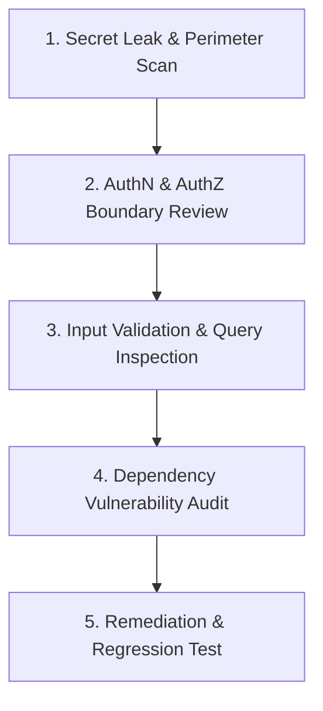

# Workflow: Security & Vulnerability Audit

> **Step-by-step threat modeling, vulnerability scanning, and remediation workflow.**

Follow this workflow when executing `/human-ui security` or performing a security review.

---

## The 5-Stage Security Audit Lifecycle

### Stage 1: Secret Leak & Perimeter Scan
1. Scan repository for hardcoded secrets, private keys, or tokens (`.env`, git history).
2. Verify that `.gitignore` contains all local environment files and key rings.
3. Check that zero secret keys are referenced in client-side bundles.

### Stage 2: Authentication & Authorization Review
1. Inspect session management: verify secure storage via `FlutterSecureStorage` (hardware keystore/keychain).
2. Check for token exposure: verify access tokens are never logged or persisted in plain `SharedPreferences`.
3. Review certificate pinning in `Dio` client to prevent Man-in-the-Middle attacks.

### Stage 3: Input Validation & Serialization
1. Verify that all API response mappings validate types and null safety gracefully.
2. Confirm that sensitive fields (passwords, auth tokens) are marked `@JsonKey(includeToJson: false)` where appropriate.
3. Check biometric authentication (`local_auth`) configurations and fallback policies.

### Stage 4: Dependency Vulnerability Audit
1. Execute package vulnerability scanner:
   - Flutter/Dart: `dart pub outdated` and security audit checks.
2. Evaluate severity of any flagged CVEs.

### Stage 5: Remediation & Security Regression Testing
1. Apply the smallest safe fix for verified vulnerabilities.
2. Add an automated security regression test verifying that malicious inputs are rejected.
3. Document audit findings and remediations in chat.

