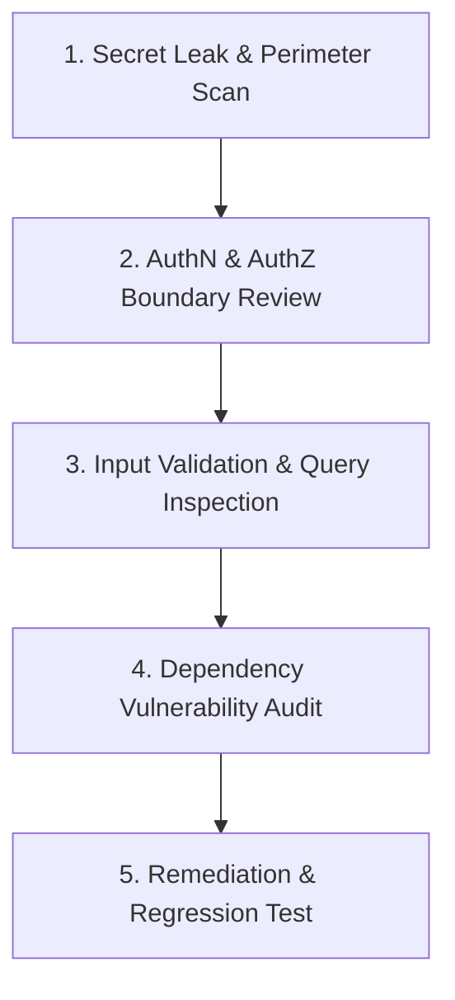

# Workflow: Security & Vulnerability Audit

> **Step-by-step threat modeling, vulnerability scanning, and remediation workflow.**

Follow this workflow when executing `/human-ui security` or performing a security review.

---

## The 5-Stage Security Audit Lifecycle

### Stage 1: Secret Leak & Perimeter Scan
1. Scan repository for hardcoded secrets, private keys, or tokens (`.env`, git history).
2. Verify that `.gitignore` contains all local environment files and key rings.
3. Check that zero secret keys are referenced in client-side bundles.

### Stage 2: Authentication & Authorization Review
1. Inspect session management: verify `HttpOnly`, `Secure`, `SameSite=Strict` cookies.
2. Check for Insecure Direct Object References (IDOR): ensure every resource lookup explicitly checks tenant/user ownership.
3. Review role-based access control (RBAC) guards on all protected API routes.

### Stage 3: Input Validation & Query Inspection
1. Verify that all endpoint inputs are validated against strict type schemas (Zod/Pydantic).
2. Audit database queries to confirm 100% parameterization (zero string interpolation).
3. Check rich text / HTML rendering for XSS vulnerabilities; verify `DOMPurify` usage.

### Stage 4: Dependency Vulnerability Audit
1. Execute package vulnerability scanner:
   - Node: `npm audit`
   - Dart/Flutter: `dart pub audit`
   - Python: `pip-audit`
   - Rust: `cargo audit`
2. Evaluate severity of any flagged CVEs.

### Stage 5: Remediation & Security Regression Testing
1. Apply the smallest safe fix for verified vulnerabilities.
2. Add an automated security regression test verifying that malicious inputs are rejected.
3. Document audit findings and remediations in chat.
