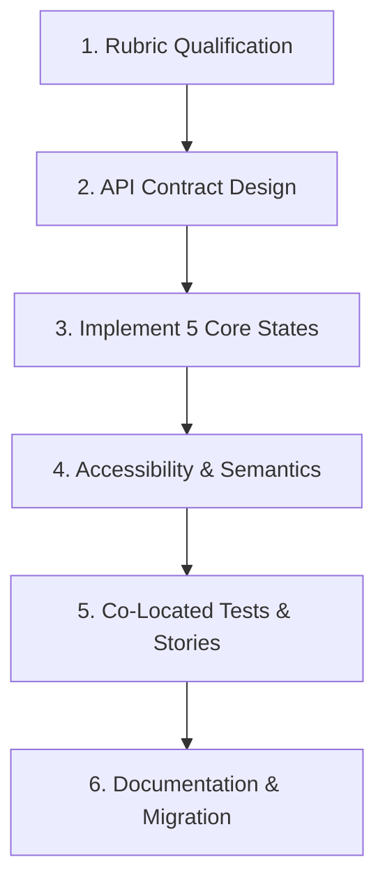

# Workflow: Creating a Shared Component

> Step-by-step execution guide for identifying, abstracting, implementing, and documenting reusable UI components.

---

## 1. Purpose

Shared components must be resilient, flexible, and backward-compatible. Creating hasty abstractions without testing all interactive states produces leaky components that break across views. 

This workflow defines the lifecycle for building a shared component.

---

## 2. Step-by-Step Component Lifecycle

### Step 1: Rubric Qualification
Answer the 6 qualification questions from [Shared Component Rules](../components/shared-component-rules.md):
- Is it used in ≥ 2 places?
- Does it have a single clear responsibility?
- Can existing components solve this?
- Is the API understandable?
- Does it need variants?
- Will abstraction ease maintenance?

### Step 2: API Contract Design
1. Define explicit types/interfaces for props/parameters.
2. Provide sensible defaults for all optional parameters.
3. Use compound components if configuration exceeds 10 props.
4. Support polymorphic rendering (`as` prop) if applicable.

### Step 3: Implement the 5 Core States
Ensure the component explicitly supports:
1. **Default / Rest**: Standard styling with design tokens.
2. **Hover / Active**: Visual and tactile feedback.
3. **Focused**: High-contrast focus ring with offset.
4. **Disabled**: Reduced opacity, non-interactive cursor, `aria-disabled="true"`.
5. **Loading**: Inline progress indicator without layout jitter or dimension shifts.

### Step 4: Accessibility & Semantics
1. Assign semantic roles and ARIA attributes (`aria-label`, `aria-expanded`, etc.).
2. Ensure touch target padding satisfies minimum dimensions (44x44pt / 48x48dp).
3. Test keyboard activation via `Enter` and `Space`.

### Step 5: Co-Located Tests & Previews
1. Write unit/component tests in `[ComponentName].test.tsx` (or `_test.dart`).
2. Test default rendering, click handlers, disabled lock, and loading states.
3. Create an interactive preview or Storybook story if the repository uses one.

### Step 6: Documentation & Caller Migration
1. Document the component's variants and usage example in a markdown docstring or story.
2. Refactor existing duplicate code to consume the new shared component.
3. Verify that existing views did not regress.

---

## 3. Related Documentation

- Master Instructions: [../AGENTS.md](../AGENTS.md)
- Shared Component Rules: [../components/shared-component-rules.md](../components/shared-component-rules.md)
- Testing: [../quality/testing.md](../quality/testing.md)
- UI Review Checklist: [../quality/ui-review.md](../quality/ui-review.md)
